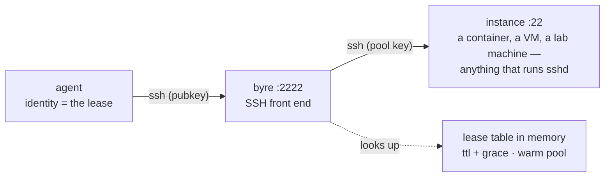

# byre

**English** · [中文](README.zh-CN.md)

byre is the SSH gateway layer for agent sandboxes: it keys the lease on **identity** — the client's
public key — not on a connection, so one agent keeps one instance exclusively until the lease expires.

An agent that syncs a working tree, builds, copies the artefact back and keeps a port forward open is one
task spread over four SSH connections. byre gives all four the same machine, without the client holding a
control master open or remembering an identifier: the key it already authenticates with is the address.

> Status: **0.3.0, pre-1.0.** Identity, lease, warm pool and adoption across restarts are verified on a
> real cluster (`docs/acceptance/`); of the four provisioning shapes only `claims` has a cluster run. Single
> replica, and no automated end-to-end gate — the cluster runs were executed by hand. The image and
> `kubectl apply -k` path were executed end to end once (prebuilt variant) and are recorded in
> `docs/acceptance/2026-11-17-deploy.md`. See [Limits](#limits-and-things-known-to-be-wrong).

> Renamed from `keypod` (see `docs/rename-to-byre.md`). Not affiliated with, endorsed by, or derived from
> any same-named project; the name is a cowshed, and the licence grants no trademark rights.

## What it is



The gateway authenticates the client with a public key and nothing else. From that key it derives an
identity, and the identity holds exactly one instance for as long as it keeps connecting. Idle time ends a
lease: after `ttl` (360s by default) plus `grace` (60s) the instance goes back to the pool. The grace
window is what makes a client's own idle timeout — 300s for `ssh` with `ControlPersist` — invisible; the
reconnect lands inside it and finds the same instance.

byre creates no containers itself. It asks a **backend** for an instance and gets back an `{id, addr,
user, key}` record, so everything about *reaching* an instance over SSH is shared across all backends.
There are four ways a backend can come by an instance — `endpoints`, `workloads`, `claims` and
`command` — and which one to use is the subject of
[Configuration](#configuration-where-do-the-ssh-backends-come-from). Two listeners, no database, no
sidecar: SSH on `:2222`, `/healthz` and `/metrics` on `:8099`. The lease table is in memory, and the
Kubernetes backends write the identity onto each instance as an annotation, which is what makes a restart
survivable — the new process re-adopts live leases before it warms anything.

Three consequences worth knowing up front. A shared private key is a shared instance, so key distribution
*is* access control and aliases in the config only change log labels. Idle is measured with the wall clock,
so an agent that thinks longer than `ttl` + `grace` comes back to a fresh instance. And instances are not
storage: anything that must outlive a lease goes somewhere else.

## Why not a plain jump host

A jump host forwards a connection to a target. Handing out an instance per connection looks like the same
thing and fails in three places:

| what happens | what the client sees | what actually broke |
|---|---|---|
| connection 2 lands on instance B | every command succeeded | its uploaded tree is on A |
| the lease expires between two commands | `cd: no such file or directory` | the instance was recycled mid-task |
| two agents share a key | one sees the other's files | key distribution, not the gateway |

The middle case is the expensive one, because every individual command succeeds: the client's bookkeeping
describes *a* filesystem, and the gateway quietly handed it three. The fix is to key allocation on
something that outlives a connection, and after authentication SSH carries exactly one such thing — the
public key the client proved possession of. That is the identity, and the lease hangs off it.

Four repairs that look obvious — source address, session id, connection-scoped containers, requiring
`ControlMaster` — and why each fails are in
[`docs/handbook/architecture.md`](docs/handbook/architecture.md).

## Quick start

**Thirty seconds, with Docker.** Nothing to edit, no Go, no cluster:

```sh
git clone https://github.com/xiyuera/byre && cd byre/examples/quickstart
./run.sh
```

It generates the keys, renders the config, builds a sandbox image, starts both containers and prints
the one `ssh` command you need. Connect twice and you get the same instance; wait out the 120s ttl and
it is released. [`examples/quickstart/`](examples/quickstart/README.md) explains what you are looking
at and how to move from it to a real deployment.

**Without Docker**, five minutes and one machine you can already reach over SSH. The simplest backend is
`provision: endpoints`: nothing is created, the gateway only decides who gets which host. For the five
minutes below that host can be any Linux box with `sshd`, including the one you are sitting at.

**1. Build.**

```sh
go build -o byre ./cmd/byre
./byre -version          # dev (none, unknown)
```

**2. Write a config.** Two endpoints, one client identity. Replace `<remote-user>`, the hostnames and the
key path; leave everything else alone for now.

```yaml
listen: ":2222"
host_key: /var/lib/byre/hostkey/id_ed25519

lease:
  ttl: 360s
  grace: 60s

backends:
  - name: lab
    provision: endpoints
    endpoints: ["instance-1.example.com:22", "instance-2.example.com:22"]
    ssh:
      user: "<remote-user>"
      private_key: /etc/byre/keys/id_key
      host_key_policy: strict

identities:
  - fingerprint: "SHA256:AAAAAAAAAAAAAAAAAAAAAAAAAAAAAAAAAAAAAAAAAAA"
    backend: lab
```

The fingerprint is the client's, not the gateway's, and `host_key` is the gateway's own key — the one
clients pin. Point `host_key` at durable storage: it is created on first start if the file is absent, and
leaving the field empty gives an ephemeral key that changes on every restart.

```sh
ssh-keygen -lf ~/.ssh/id_ed25519.pub -E sha256
# 256 SHA256:ihSSTfidE8FBRGaLem2sknNk2tDW5LM67WReyPggABU you@laptop (ED25519)
```

**3. Validate before starting.** This reads the file, applies defaults, builds every driver without
touching a cluster, and exits 2 on any violation — listing all of them at once:

```sh
./byre -check-config -config config.yaml; echo "rc=$?"
```

```
{"level":"INFO","msg":"configuration accepted","listen":":2222","host_key":"/var/lib/byre/hostkey/id_ed25519","backends":1,"identities":1,"ttl":"6m0s","grace":"1m0s","pool_size":2,"version":"dev (none, unknown)"}
rc=0
```

`rc=0` means the file is self-consistent, and nothing more: a `<placeholder>` where a value belongs and
the all-zero fingerprint shipped in `deploy/config.example.yaml` both pass, because only the shape is
checked. It says nothing about the cluster, the instances, or whether the keys exist.

**4. Start it.**

```sh
./byre -config config.yaml
```

```
{"level":"INFO","msg":"configuration accepted","listen":":2222","host_key":"/var/lib/byre/hostkey/id_ed25519","backends":1,"identities":1,"ttl":"6m0s","grace":"1m0s","pool_size":2,"version":"dev (none, unknown)"}
{"level":"WARN","msg":"generated a new host key and persisted it","path":"/var/lib/byre/hostkey/id_ed25519","fingerprint":"SHA256:VdUlcld0d1sqsRaX5qTtINtES2iIIFsLiYBxVmAuzC0","note":"clients that pinned a previous key must be updated"}
{"level":"INFO","msg":"ssh front end listening","addr":"[::]:2222","identities":1}
{"level":"INFO","msg":"health endpoint listening","addr":":8099"}
```

The `WARN` appears once, on the first start, and never again: the key is written to `host_key` and
reused. These listings drop the `time` field, which every line carries. `-listen 127.0.0.1:2223`
overrides the address from the file for one run.

**5. Connect.** The username is ignored — the key decides everything — so `anything` is as good as
anything else. Connect twice and watch the gateway's log: both lines name the same `instance`.

```sh
ssh -p 2222 -i ~/.ssh/id_ed25519 \
    -o IdentitiesOnly=yes -o StrictHostKeyChecking=accept-new \
    anything@127.0.0.1 'hostname; ls'
```

```
{"level":"INFO","msg":"session open","identity":"ihSSTfidE8FBRGaL","backend":"lab","instance":"instance-1.example.com:22"}
{"level":"INFO","msg":"session open","identity":"ihSSTfidE8FBRGaL","backend":"lab","instance":"instance-1.example.com:22"}
```

A second identity — another key under `identities` — gets the other endpoint. A key nobody registered is
refused during authentication: `Permission denied (publickey)`.

**6. Look at the two HTTP endpoints.** They are the only observability there is:

```sh
curl -s localhost:8099/healthz                  # ok dev (none, unknown)
curl -s localhost:8099/readyz                    # ready: pool target map[l:2] warm map[l:2]
curl -s localhost:8099/metrics | grep '^byre_'  # byre_up 1, byre_leases_idle 1, byre_pool_target{backend="lab"} 0
```

`/healthz` answers "the process is up". `/readyz` answers the other question — "can this process provision
an instance" — and stays 503 while a configured pool is empty and the last fill failed (ADR-0011). Note that
`pool_size` is a no-op for `endpoints`, which creates nothing to pre-warm.

The health port `:8099` is compiled in, not configurable: a second gateway on the same host starts its SSH
listener, then logs `health endpoint failed: listen tcp :8099: bind: address already in use` and shuts down.

## Configuration: where do the SSH backends come from

A backend answers two questions: how does an instance come into existence, and how is it reached over SSH?
The first is `provision`, and there are four values. None of them names a product.

| `provision` | instance comes from | what byre needs | use it when |
|---|---|---|---|
| `endpoints` | a list of hosts that already exist | nothing — a plain TCP dial | you manage machines yourself, or want to try this out |
| `workloads` | a Pod byre creates in Kubernetes | create and delete pods in that namespace | every lease should be a fresh container |
| `claims` | an object byre creates through a claim API | read and write that CRD | you already run a claim-shaped controller |
| `command` | a program you write, which byre runs | nothing — process execution | cloud VMs, Incus/LXD, a CMDB |

In one line each, for the decision a new reader is actually making: hosts you already have → `endpoints`;
a cluster with a claim CRD or a warm pool → `claims`; a cluster and only an image that runs `sshd` →
`workloads`; anything reachable only through a CLI or a CMDB → `command`. The same table with the failure
modes of each shape is at the top of [`docs/handbook/backends.md`](docs/handbook/backends.md).

Shared by all four, and deliberately outside the provision block: `ssh.user`, `ssh.private_key` (the
gateway's own key, installed on the instance), `ssh.host_key_policy` (`strict` for long-lived hosts,
`accept-new` for disposable ones) and the readiness timeout. In every shape, "the instance trusts the
gateway's public key" is the requirement you satisfy yourself — byre cannot install it on an `endpoints`
host, and for `workloads` it is baked into the image.

`ssh.port` parses and is range-checked, but **no driver reads it**: the port comes from the `addr` a
driver returns or from the `host:port` entries in `endpoints`. Setting it to anything other than 22 does
not move the dial.

The four entries below are backend fragments: they go under `backends:`, next to the `listen`, `lease` and
`identities` from Quick start, or in `deploy/config.example.yaml`. Run on their own they exit 2 with
`at least one identity is required` — that is the fragment being a fragment, not a mistake in it.

### endpoints — hosts that already exist

```yaml
  - name: lab
    provision: endpoints
    endpoints: ["instance-1.example.com:22", "instance-2.example.com:22"]
    ssh: {user: "<remote-user>", private_key: /etc/byre/keys/id_key, host_key_policy: strict}
```

Nothing is provisioned and nothing is destroyed: one endpoint is leased to one identity at a time,
round-robin over the free ones, and marked free on release. There is no pool, because there is nothing to
create ahead of demand — `pool_size` only applies to drivers that can.

The instance name you see in the log and in `/metrics` is the endpoint's own `host:port`; only
`claims` and `workloads` produce names of their own shape (`byre-…`). Nothing is renamed on the way
through.

Two consequences. The number of endpoints is the number of concurrent identities; past that, `Acquire`
fails with `no capacity`. And a released endpoint still holds whatever the last identity left in it, so
cleanup is the host's problem and one identity per endpoint is the only safe default. See
[`examples/static-endpoints/`](examples/static-endpoints/README.md).

### workloads — a pod per lease

```yaml
  - name: adhoc
    provision: workloads
    namespace: "<namespace>"
    provider:
      image: "<registry>/<image>:<tag>"
      start_command: ["/usr/sbin/sshd", "-D", "-e"]
      ready_timeout: 180s
    ssh: {user: "<remote-user>", private_key: /etc/byre/keys/id_key, host_key_policy: accept-new}
```

The instance is a Pod created from an image that runs `sshd` and trusts the pool key. Readiness is
Kubernetes' own — used once it reports `PodReady` and has a `podIP` — and release deletes the pod. This is
the least-tested shape (unit tests with a fake client); `claims` is what the recorded cluster run used.

### claims — ask a controller to hand one over

```yaml
  - name: pooled
    provision: claims
    namespace: "<namespace>"
    provider:
      template: "<template-name>"
      warm_pool: "<warm-pool-name>"
      api_group: "<api-group>"
      api_version: "<api-version>"
      resource: "<plural-resource>"
      object_kind: "<Kind>"
      endpoint_field: ["status", "sandbox", "serviceFQDN"]
      ready_timeout: 120s
    ssh: {user: "<remote-user>", private_key: /etc/byre/keys/id_key, host_key_policy: accept-new}
```

`claims` is an API *shape* — create an object, wait for an address in its status, delete it at the end —
not a built-in CRD, which is why the GVK is configuration. Readiness is a **complete SSH banner** on port 22:
the first address that answers with a line starting `SSH-2.` is ready, in the order given by
`endpoint_field` and then `status.sandbox.podIPs`. An open socket is not enough — socket-activated sshd
accepts the connection before it can speak — and a status field merely appearing is not enough either,
because the Service's DNS record follows the controller by seconds (ADR-0005). The deployment this was
written against uses `SandboxClaim` from `extensions.agents.x-k8s.io` with a warm pool — one claim API
among many, and only configuration here.

### command — your program provisions

```yaml
  - name: cloud
    provision: command
    command:
      acquire: ["/usr/local/bin/provision-ci-vm"]
      release: ["/usr/local/bin/destroy-ci-vm"]
      list: ["/usr/local/bin/list-ci-vms"]
      timeout: 120s
      env: ["CLOUD_PROFILE=ci"]
    ssh: {user: "<remote-user>", private_key: /etc/byre/keys/id_key, host_key_policy: accept-new}
```

`acquire` prints exactly one JSON object on stdout —
`{"id":"vm-17","addr":"192.0.2.17:22","user":"ci","private_key":"/path/key"}` — with `BYRE_IDENTITY` in its
environment; `user` and `private_key` may be omitted, and then the `ssh` block is the fallback. `release`
gets `BYRE_INSTANCE_ID` and `BYRE_INSTANCE_ADDR`. Readiness is `addr` as printed — implementing the wait is
your program's business.

`list` is what lets a restarted gateway adopt. An instance is adopted when its record carries
`"annotations":{"byre.io/identity":"<fingerprint>"}`, printed by **both** `acquire` and `list`; an
instance reported without one is kept and logged (`instance kept at startup`), never destroyed — a
gateway that cannot attribute an instance may not delete it (ADR-0009). Without `list`, a restart adopts
nothing and whatever your program left running stays running, outside the gateway's accounting. The full
contract, with a worked example script, is in [`docs/handbook/backends.md`](docs/handbook/backends.md).

An identity is one client key. `fingerprint` comes from `ssh-keygen -lf key.pub -E sha256`, and
`SHA256:` plus base64 padding are normalised away, so two spellings of one key cannot become two
identities. `aliases` are log labels only, never routing. A key that is not listed never completes
authentication: there is no anonymous access and no per-connection default.

## Deploy: Docker and Kubernetes

A container image and a kustomize overlay live in the repo; neither is needed to try the gateway.

```sh
# 1. build and publish the image — the cluster can only pull from a registry, never from your disk
make image-push IMAGE_REGISTRY=<registry>/<team>   # pushes <registry>/<team>/byre:<tag>
docker inspect --format '{{index .RepoDigests 0}}' <registry>/<team>/byre:<tag>   # the digest to pin
# 2. put that reference into deploy/: what is checked in is a placeholder, not a working default
#      deploy/deployment.yaml:39              image: <registry>/byre@sha256:<digest>
#      deploy/kustomization.yaml  (images:)   name:    <registry>/byre@sha256:<digest>
#                                             newName: <registry>/<team>/byre
#                                             digest:  sha256:<digest>
#    kustomize matches the reference as written — `<digest>` is not a digest it can parse — so both
#    lines have to spell the placeholder the same way.
# 3. the pool key: the Deployment mounts it as a Secret, and a missing one is not a warning
kubectl -n byre-system create secret generic byre-pool-key --from-file=id_key=/path/to/key
# 4. the gateway itself
kubectl apply -k deploy/                              # ns, SA, RBAC, ConfigMap, Deployment, Service
# 5. the grant that lives in the instances' namespace — fill in both namespaces first
INSTANCES_NS=<instances-ns> GATEWAY_NS=byre-system \
  sed -e "s/__INSTANCES_NS__/$INSTANCES_NS/g" -e "s/__GATEWAY_NS__/$GATEWAY_NS/g" \
  deploy/instances-rbac.example.yaml | kubectl apply -f -
kubectl -n byre-system rollout status deploy/byre
```

Two ways for that to fail before anything is leased, and neither looks like a configuration problem:
without step 2 the pod stops in `ImagePullBackOff` (`<registry>/byre@sha256:<digest>` is a placeholder;
kubelet cannot resolve it), and without step 3 it stops in `CreateContainerConfigError` — the pool-key
volume is not `optional`.

The split apply is not laziness. `kubectl apply -k deploy/` installs the gateway in its own namespace,
while the instances it leases live in another, and kustomize's `namespace:` rewrites every object at once —
so that grant has to be applied on its own. Skipping it is the most misleading failure this project has:
`/healthz` stays green, the pool never warms, and every checkout returns 403.

The gateway's host key lives on its own PVC (`deploy/hostkey-pvc.yaml`), because it is the identity clients
pin; the pool key — byre's key *to* the instances — comes from the Secret above. Rolling the Deployment
adopts live leases first, so a client that reconnects during a rollout keeps its instance, but the SSH
connections themselves are cut: there is no connection hand-off. The process lets go of them itself after
`-shutdown-delay` (2s) instead of waiting out the grace period. Install, rotation, RBAC and symptoms:
[`docs/handbook/operations.md`](docs/handbook/operations.md).

## How it compares

| category | examples | what it solves | where it differs from byre |
|---|---|---|---|
| Enterprise access proxies | Teleport, HashiCorp Boundary | people reaching production machines: short-lived certificates, audit, RBAC | the unit is a person and a host that already exists; nothing allocates or recycles instances |
| SSH reverse proxies | [sshpiper](https://github.com/tg123/sshpiper) | one entry point, routing a connection to an upstream sshd by username or plugin | routing is a static map; nothing is created or leased, and the same client may land on a different upstream next time |
| microVM lease gateways | [spoond](https://github.com/jrimmer/spoond) | leases in front of Firecracker microVMs, with an SSH gateway, TTL and re-attach | closest in spirit: the client addresses its lease as `<lease-id>@host` or a friendly tag, a string it must remember and present, and the substrate is its own orchestrator |
| agent-sandbox SSH examples | [Containarium SSH Sandbox](https://agent-sandbox.sigs.k8s.io/docs/use-cases/examples/containarium-ssh-sandbox/) | an agent holds an SSH key instead of cluster credentials; each session is forced into an MCP server | the session is pinned by a forced command; no identity lease, no TTL, and the sandbox is addressed by whatever name the client dials |

The gap all four leave is the same: a client that comes back three minutes later is either not recognised
at all, or recognised only because it repeats an identifier it was handed earlier. byre takes the one
identifier SSH already verifies — the public key — and hangs the lease on it. The price is in
[Limits](#limits-and-things-known-to-be-wrong).

## Limits and things known to be wrong

- **Single replica.** One process holds the lease table, so a second replica would give one identity two
  instances. The multi-replica designs are written down in `docs/roadmap.md`; neither is implemented.
- **`/healthz` does not mean "I can hand out an instance".** It answers "the process is up" and prints the
  version stamped into the binary. A gateway missing its cross-namespace grant is green, never warms its
  pool, and refuses every checkout with a 403.
- **`provision: command` adopts only what it can attribute.** A restart adopts the instances `list`
  reports with `annotations.byre.io/identity` and keeps the rest with a warning — a deliberate leak in
  place of a destructive cleanup, so an un-annotated lister leaves warm capacity behind rather than
  destroying live leases. Printing the annotation in `acquire` but not in `list` (or the reverse) gives an
  instance that is listed but never matched to the identity that reconnects.
- **No automated end-to-end gate.** The cluster runs in `docs/acceptance/` were executed and recorded by
  hand. The harness is `BYRE_CFG=config.yaml BYRE_KEY=<client key> test/e2e/run.sh [--ttl-ok]` (or the same
  through `make e2e CONFIG=… KEY=…`); it asserts against a gateway that is already running, and without
  those two variables it prints `No target given` and exits 2. The `kind`-based CI run is a roadmap item.
- **`endpoints` does not survive a restart.** That driver keeps ownership in memory, so a restarted
  gateway round-robins again and a client that reconnects lands on whichever endpoint is next — measured,
  not inferred. `claims` and `workloads` do survive: the identity is written onto the object.
- **`grace: 0s` does not mean "no grace".** `ApplyDefaults` replaces an explicit zero with 60 s, and there is
  still no way to disable it. `pool_size: 0`, by contrast, now means what it says: no warm capacity.
- **Not in v1:** multi-replica consistency, dynamic backend balancing, in-instance state persistence,
  multi-tenancy, a UI. Anything specific to one product belongs in an integration example.

## Documentation

| document | what it answers |
|---|---|
| [handbook/architecture.md](docs/handbook/architecture.md) | identity, lease, pool, backends, readiness — how the pieces fit, and why the obvious repairs fail |
| [handbook/backends.md](docs/handbook/backends.md) | the four provisions in detail: field tables, readiness, failure behaviour, the `command` contract |
| [handbook/operations.md](docs/handbook/operations.md) | install, RBAC, host-key rotation, metrics, upgrading, symptoms |
| [handbook/troubleshooting.md](docs/handbook/troubleshooting.md) | what each failure looks like from the client and from the gateway log |
| [examples/](examples/) | one runnable configuration per shape, plus `examples/local-quickstart/` — the Quick start above as a file you can copy |
| [examples/docker-sandbox/](examples/docker-sandbox/README.md) · [examples/kubernetes-sandbox/](examples/kubernetes-sandbox/README.md) | the two starter kits: a complete gateway + sandbox deployment on plain docker, and the same on Kubernetes with a claim-based controller |
| [charts/byre/](charts/byre/README.md) | the same Kubernetes shape as a Helm chart — defaults install and start, `sandbox.enabled` adds the template and pool |
| [roadmap.md](docs/roadmap.md) · [adr/](docs/adr/) | what is absent from v1 and in what order it would arrive; the decisions, with the conditions that would reverse them |
| [acceptance/](docs/acceptance/) · [docs/README.md](docs/README.md) | what was verified on a real cluster; the index of everything else |

Some of it is English only, and saying so beats a reader discovering it: the four handbook pages,
`docs/release.md`, `docs/i18n.md`, `docs/integrations/README.md`, `deploy/gitea-runner/README.md`,
`docs/adr/*` and `docs/acceptance/*`, and the shape and starter-kit examples under `examples/`.
`scripts/check-i18n.sh` prints the pages it tracks as `UNTRANSLATED` instead of skipping them; the
remaining ones are English only by the rule in [`docs/i18n.md`](docs/i18n.md), not by omission.

## Dependencies

`golang.org/x/crypto/ssh` for the protocol; `k8s.io/client-go` with `api` and `apimachinery` for the
`claims` and `workloads` backends (the other two need none of it at runtime); `gopkg.in/yaml.v3` for the
configuration file. Five direct modules, no gateway, proxy, cache or sidecar — one static binary with two
listeners. Licences: [THIRD_PARTY_NOTICES.md](THIRD_PARTY_NOTICES.md).

## Contributing

`main` is protected: direct pushes are rejected for every account, the owner's
included. Changes go through a pull request with four green checks and one
approval. The rules, and the two operations that are exempt from them, are in
[CONTRIBUTING.md](CONTRIBUTING.md).

Participation is covered by [`CODE_OF_CONDUCT.md`](CODE_OF_CONDUCT.md), adapted from the Contributor
Covenant 2.1.

## License

Apache-2.0 — see [LICENSE](LICENSE) and [NOTICE](NOTICE).
