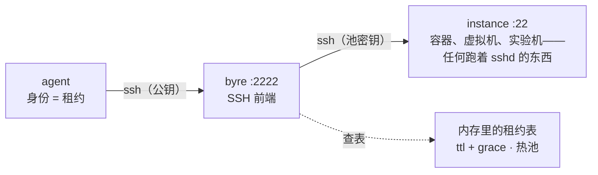

# byre

[English](README.md) · **中文**

byre 是给 agent 沙箱用的 SSH 网关层：租约挂在**身份**（客户端的公钥）上，而不是挂在一条连接上，所以一个
agent 在租约有效期内独占一个实例。

一个 agent 同步工作树、构建、把产物拷回去、再留一条端口转发跑测试，这件事是四个 SSH 连接。byre 让这四个
连接落到同一台机器上，客户端既不用保持 control master，也不用记住任何标识符：它认证时用的那把公钥，就是
地址。

> 状态：**0.3.0，1.0 之前**。身份、租约、热池、重启后的接管在真实集群上验证过（`docs/acceptance/`）；四种
> provision 里只有 `claims` 有集群实测。单副本，并且没有自动化端到端门禁——集群实测是人工执行记录的。镜像与
> `kubectl apply -k` 这条路径真跑通过一次（prebuilt 变体），记录在
> `docs/acceptance/2026-11-17-deploy.md`。见 [限制](#限制与已知问题)。

> 由 `keypod` 改名而来（见 `docs/rename-to-byre.md`）。与任何同名项目无关，未获其背书，也不派生自它们；
> 这个名字指牛棚，许可证不授予任何商标权。

## 这是什么



网关只用公钥认证客户端，不看别的。它从这把公钥推导出一个身份，这个身份在持续连接期间独占一个实例。结束
租约的是空闲时间：`ttl`（默认 360s）加 `grace`（60s）之后实例回池。grace 窗口正是为了掩盖客户端自己的
空闲超时（`ssh` 配 `ControlPersist` 时是 300s）——重连落在窗口内，拿到同一个实例。

byre 自己不创建容器。它向**后端**要一个实例，拿回一条 `{id, addr, user, key}` 记录，所以"怎么通过 SSH
够到实例"这部分对四种后端都一样；实例从哪来有四种形态——`endpoints`、`workloads`、`claims`、`command`——
用哪种，是
[配置](#配置后端的-sshd-从哪来)一节的内容。两个监听、没有数据库、没有 sidecar：`2222` 给 SSH 客户端，
`8099` 给 `/healthz` 与 `/metrics`。租约表在内存里，Kubernetes 后端的实例身上带一个注明身份的注解，这
正是重启能活下来的原因——新进程先接管活着的租约，再去预热。

三个值得先知道的推论。共享私钥就是共享实例，所以密钥分发本身就是访问控制，配置里的别名只影响日志标签。
空闲按墙上时钟计算，想事情超过 `ttl` + `grace` 的 agent 回来会看到新实例。实例不是存储：任何必须比租约活得
久的东西都得放到别处。

## 为什么不是普通跳板机

跳板机把一条连接转发到目标。按连接分配实例看起来是一回事，但会在三个地方翻车：

| 发生什么 | 客户端看到什么 | 真正坏在哪 |
|---|---|---|
| 第二条连接落到实例 B | 每条命令都成功了 | 上传的工作树在 A 上 |
| 两条命令之间租约到期 | `cd: no such file or directory` | 实例在任务中途被回收了 |
| 两个 agent 共用一把钥匙 | 一个能看到另一个的文件 | 问题在密钥分发，不在网关 |

中间那种最贵，因为每一条单独的命都成功了：客户端记账簿描述的是*一个*文件系统，而网关悄悄给了它三个。
修法是让分配挂在比连接活得久的东西上，而认证之后的 SSH 连接上恰好有这样一样东西——客户端证明自己持有的
那把公钥。那就是身份，租约挂在它上面。

四种看起来显然的修法——源地址、会话 id、按连接容器的实例、强制客户端保持 `ControlMaster`——以及它们各自
为什么不行，见 [`docs/handbook/architecture.md`](docs/handbook/architecture.md)。

## 快速开始

需要 Go 1.23+，以及至少一台你能 SSH 连到的机器。最简单的后端是 `provision: endpoints`：它什么都不创建，
网关只决定谁拿到哪台主机。下面这五分钟里，那台机器可以是任何跑着 `sshd` 的 Linux，包括你正坐着的这台。

**1. 构建。**

```sh
go build -o byre ./cmd/byre
./byre -version          # dev (none, unknown)
```

**2. 写配置。** 两个端点、一个客户端身份。把 `<remote-user>`、主机名和密钥路径换掉，其余先别动。

```yaml
listen: ":2222"
host_key: /var/lib/byre/hostkey/id_ed25519

lease:
  ttl: 360s
  grace: 60s

backends:
  - name: lab
    provision: endpoints
    endpoints: ["instance-1.example.com:22", "instance-2.example.com:22"]
    ssh:
      user: "<remote-user>"
      private_key: /etc/byre/keys/id_key
      host_key_policy: strict

identities:
  - fingerprint: "SHA256:AAAAAAAAAAAAAAAAAAAAAAAAAAAAAAAAAAAAAAAAAAA"
    backend: lab
```

指纹是客户端的，不是网关的；`host_key` 才是网关自己的密钥，也就是客户端要 pin 的那把。把 `host_key`
指向可持续的存储：文件不存在时它会在首次启动时被创建，而把这个字段留空会得到一把每次重启都变的临时密钥。

```sh
ssh-keygen -lf ~/.ssh/id_ed25519.pub -E sha256
# 256 SHA256:ihSSTfidE8FBRGaLem2sknNk2tDW5LM67WReyPggABU you@laptop (ED25519)
```

**3. 启动前先校验。** 它读取文件、套用默认值、把每个 driver 都构建一遍（不碰集群），任何违规都返回 2，
并一次列出全部问题：

```sh
./byre -check-config -config config.yaml; echo "rc=$?"
```

```
{"level":"INFO","msg":"configuration accepted","listen":":2222","host_key":"/var/lib/byre/hostkey/id_ed25519","backends":1,"identities":1,"ttl":"6m0s","grace":"1m0s","pool_size":2,"version":"dev (none, unknown)"}
rc=0
```

`rc=0` 只说明文件自洽，不说明别的：本该填值的地方留着 `<placeholder>`、以及
`deploy/config.example.yaml` 里那串全零指纹，都会通过——它校验的是形状。它对集群、对实例、对钥匙是否存在
一无所知。

**4. 启动。**

```sh
./byre -config config.yaml
```

```
{"level":"INFO","msg":"configuration accepted","listen":":2222","host_key":"/var/lib/byre/hostkey/id_ed25519","backends":1,"identities":1,"ttl":"6m0s","grace":"1m0s","pool_size":2,"version":"dev (none, unknown)"}
{"level":"WARN","msg":"generated a new host key and persisted it","path":"/var/lib/byre/hostkey/id_ed25519","fingerprint":"SHA256:VdUlcld0d1sqsRaX5qTtINtES2iIIFsLiYBxVmAuzC0","note":"clients that pinned a previous key must be updated"}
{"level":"INFO","msg":"ssh front end listening","addr":"[::]:2222","identities":1}
{"level":"INFO","msg":"health endpoint listening","addr":":8099"}
```

那条 `WARN` 只在首次启动出现一次，之后不会再有：密钥被写进 `host_key` 并复用。上面这些日志去掉了每行都带的
`time` 字段。`-listen 127.0.0.1:2223` 可以在这一次运行里覆盖文件里的地址。

**5. 连上去。** 用户名被忽略——决定一切的是密钥——所以 `anything` 和别的写法一样。连两次，然后看网关日志：
两行的 `instance` 相同。

```sh
ssh -p 2222 -i ~/.ssh/id_ed25519 \
    -o IdentitiesOnly=yes -o StrictHostKeyChecking=accept-new \
    anything@127.0.0.1 'hostname; ls'
```

```
{"level":"INFO","msg":"session open","identity":"ihSSTfidE8FBRGaL","backend":"lab","instance":"instance-1.example.com:22"}
{"level":"INFO","msg":"session open","identity":"ihSSTfidE8FBRGaL","backend":"lab","instance":"instance-1.example.com:22"}
```

第二个身份（`identities` 里再加一把钥匙）拿到另一个端点。没登记过的钥匙在认证阶段就被拒：
`Permission denied (publickey)`。

**6. 看两个 HTTP 端点。** 可观测性只有这些：

```sh
curl -s localhost:8099/healthz                  # ok dev (none, unknown)
curl -s localhost:8099/readyz                    # ready: pool target map[l:2] warm map[l:2]
curl -s localhost:8099/metrics | grep '^byre_'  # byre_up 1, byre_leases_idle 1, byre_pool_target{backend="lab"} 0
```

`/healthz` 回答的是"进程活着"。另一个问题——"这个进程现在能不能发实例"——由 `/readyz` 回答：配置了热池却
没预热成功时它一直是 503（ADR-0011）。另外 `pool_size` 对 `endpoints` 无效，因为没有东西可以预热。

健康端口 `:8099` 是编进二进制的、不可配：同一台机器上的第二个网关会先绑上 SSH 监听，然后打出
`health endpoint failed: listen tcp :8099: bind: address already in use` 并退出。

## 配置：后端的 sshd 从哪来

后端回答两个问题：实例怎么产生，怎么通过 SSH 够到它。第一个是 `provision`，取四个值，没有一个值写的是产品名。

| `provision` | 实例从哪来 | byre 需要什么 | 什么时候用 |
|---|---|---|---|
| `endpoints` | 你给的一批已存在的机器 | 什么都不需要，纯 TCP 拨号 | 机器自己管，或者只想先跑起来 |
| `workloads` | 在 Kubernetes 里创建 Pod | 在该 namespace 创建和删除 pod | 每个租约都该是一个新容器 |
| `claims` | 通过 claim API 创建对象 | 读写那个 CRD | 你已经在跑 claim 形状的控制器 |
| `command` | 你写一个程序，byre 调它 | 什么都不需要，进程执行 | 云主机、Incus/LXD、CMDB |

按你手上已有的东西选，一句话一条：已经有一批能 SSH 的机器 → `endpoints`；有集群且有 claim 形状的 CRD 或热池
→ `claims`；有集群、只有能跑 `sshd` 的镜像 → `workloads`；只能通过 CLI 或 CMDB 拿到 → `command`。同样一张表
连同各自的失败形态，见 [`docs/handbook/backends.md`](docs/handbook/backends.md) 开头。

四种共有、并且刻意放在 provision 块之外的字段：`ssh.user`、`ssh.private_key`（网关自己的、装在实例上的
钥匙）、`ssh.host_key_policy`（长命主机用 `strict`，一次性实例用 `accept-new`），以及就绪超时。
无论哪种形态，"实例信任网关的公钥"这条都得你自己满足——byre 没法替你往 `endpoints` 主机上装，`workloads`
则要求它烘进镜像里。

`ssh.port` 会被解析、也会做范围校验，但**没有任何 driver 读它**：端口来自 driver 返回的 `addr`，或者
`endpoints` 里每条 `host:port`。把它写成 22 以外的值不会改变拨号目标。

下面四段是 backend 片段：放在 `backends:` 下，与快速开始里的 `listen`、`lease`、`identities` 并列，或者放进
`deploy/config.example.yaml`。单独拿去跑会以 rc=2 报 `at least one identity is required`——那是片段本来就是
片段，不是它写错了。

### endpoints——已存在的机器

```yaml
  - name: lab
    provision: endpoints
    endpoints: ["instance-1.example.com:22", "instance-2.example.com:22"]
    ssh: {user: "<remote-user>", private_key: /etc/byre/keys/id_key, host_key_policy: strict}
```

不创建也不销毁：一个端点同一时间租给一个身份，在空闲端点里轮转，释放时标记为空闲。没有池，因为没有东西可以
提前创建——`pool_size` 只对能创建容量的 driver 有效。

日志与 `/metrics` 里的实例名就是端点自己的 `host:port`；只有 `claims` 与 `workloads` 会给出自己形状的名字
（`byre-…`），一路上不做任何改名。

两个后果。端点数量就是并发身份的容量上限，超了 `Acquire` 返回 `no capacity`。还有，释放后的端点里还留着上
一个身份的东西，清理是主机自己的事，所以一个身份一个端点才是唯一安全的默认。见
[`examples/static-endpoints/`](examples/static-endpoints/README.md)。

### workloads——一个租约一个 pod

```yaml
  - name: adhoc
    provision: workloads
    namespace: "<namespace>"
    provider:
      image: "<registry>/<image>:<tag>"
      start_command: ["/usr/sbin/sshd", "-D", "-e"]
      ready_timeout: 180s
    ssh: {user: "<remote-user>", private_key: /etc/byre/keys/id_key, host_key_policy: accept-new}
```

实例是用一个跑 `sshd`、信任 pool key 的镜像创建出来的 Pod。就绪用 Kubernetes 自己的判据——报 `PodReady`
且有 `podIP` 才用——释放时删 Pod。这是四种里测得最少的一种（只有带假客户端的单测），记录的集群实测用的是
`claims`。

### claims——让控制器交一个出来

```yaml
  - name: pooled
    provision: claims
    namespace: "<namespace>"
    provider:
      template: "<template-name>"
      warm_pool: "<warm-pool-name>"
      api_group: "<api-group>"
      api_version: "<api-version>"
      resource: "<plural-resource>"
      object_kind: "<Kind>"
      endpoint_field: ["status", "sandbox", "serviceFQDN"]
      ready_timeout: 120s
    ssh: {user: "<remote-user>", private_key: /etc/byre/keys/id_key, host_key_policy: accept-new}
```

`claims` 是一种 API*形状*——创建对象、等 status 里出现地址、结束时删掉——不是内置的某个 CRD，所以 GVK
是配置项。就绪判据是**完整读到一行 SSH banner**：按 `endpoint_field` 给的顺序，再退到
`status.sandbox.podIPs`，第一个回出 `SSH-2.` 开头的行的胜出。端口能连上不算——socket 激活的 sshd 会先接
下连接、后才会说话；光有 status 字段也不算，因为 Service 的 DNS 记录比控制器晚几秒（ADR-0005）。本项目
当初对着的部署用的是 `extensions.agents.x-k8s.io` 的 `SandboxClaim` 加热池，那只是众多 claim API 中的
一个，在这里也只是配置。

### command——你自己供给

```yaml
  - name: cloud
    provision: command
    command:
      acquire: ["/usr/local/bin/provision-ci-vm"]
      release: ["/usr/local/bin/destroy-ci-vm"]
      list: ["/usr/local/bin/list-ci-vms"]
      timeout: 120s
      env: ["CLOUD_PROFILE=ci"]
    ssh: {user: "<remote-user>", private_key: /etc/byre/keys/id_key, host_key_policy: accept-new}
```

`acquire` 在 stdout 上只打印一个 JSON 对象——
`{"id":"vm-17","addr":"192.0.2.17:22","user":"ci","private_key":"/path/key"}`——环境里有 `BYRE_IDENTITY`；
`user` 与 `private_key` 可以省略，那时用 `ssh` 块里的值兜底。`release` 拿到 `BYRE_INSTANCE_ID` 与
`BYRE_INSTANCE_ADDR`。就绪判据就是打印出来的 `addr`——等待逻辑属于你的程序。

`list` 是重启后**接管**的依据：实例的记录里带 `"annotations":{"byre.io/identity":"<fingerprint>"}` 才会被
接管，而这个注解必须由 `acquire` 与 `list` **两边都**打印；没有注解的实例会被保留并记一条
`instance kept at startup`，绝不会被销毁——归不了属的实例，网关无权删（ADR-0009）。不配 `list`，重启就
什么也接管不到，你的程序留下的实例一直留在外面，只是不在网关的账上。完整契约与一份示例脚本见
[`docs/handbook/backends.md`](docs/handbook/backends.md)。

一个身份就是一把客户端密钥。`fingerprint` 来自 `ssh-keygen -lf key.pub -E sha256`，`SHA256:` 前缀与
base64 补位都会被归一化，所以同一把钥匙的两种写法不会变成两个身份。`aliases` 只用于日志标签，从不参与路由。
没登记的钥匙永远过不了认证：没有匿名访问，也没有按连接兜底的默认值。

## 部署：Docker 与 Kubernetes

仓库里有容器镜像和 kustomize overlay；想先试试网关，两个都不需要。

```sh
# 1. 构建并推送到 registry——集群只能从 registry 拉，拉不到你本机
make image-push IMAGE_REGISTRY=<registry>/<team>   # 推出 <registry>/<team>/byre:<tag>
docker inspect --format '{{index .RepoDigests 0}}' <registry>/<team>/byre:<tag>   # 要钉的 digest
# 2. 把这条引用填进 deploy/：仓库里放的是占位符，不是能跑的默认值
#      deploy/deployment.yaml:39              image: <registry>/byre@sha256:<digest>
#      deploy/kustomization.yaml  (images:)   name:    <registry>/byre@sha256:<digest>
#                                             newName: <registry>/<team>/byre
#                                             digest:  sha256:<digest>
#    kustomize 按字面匹配这个引用（`<digest>` 不是它能解析的 digest），所以两处占位符必须写成一样。
# 3. pool key：Deployment 以 Secret 挂载它，缺了不是警告
kubectl -n byre-system create secret generic byre-pool-key --from-file=id_key=/path/to/key
# 4. 网关本体
kubectl apply -k deploy/                              # ns、SA、RBAC、ConfigMap、Deployment、Service
# 5. 落在实例所在 namespace 的那条授权——先把两个 namespace 填进去
INSTANCES_NS=<instances-ns> GATEWAY_NS=byre-system \
  sed -e "s/__INSTANCES_NS__/$INSTANCES_NS/g" -e "s/__GATEWAY_NS__/$GATEWAY_NS/g" \
  deploy/instances-rbac.example.yaml | kubectl apply -f -
kubectl -n byre-system rollout status deploy/byre
```

有两条会在租出第一个实例之前就失败，而且看起来都不像配置问题：跳过第 2 步，Pod 停在 `ImagePullBackOff`
（`<registry>/byre@sha256:<digest>` 是占位符，kubelet 解析不了）；跳过第 3 步，Pod 停在 `CreateContainerConfigError`——
pool key 那个卷不是 `optional`。

分开 apply 不是偷懒。`kubectl apply -k deploy/` 把网关装进它自己的 namespace，而它租的实例在另一个
namespace，kustomize 的 `namespace:` 又会一次性改写所有对象——所以那条授权只能单独 apply。漏掉它是这个项目
最容易误导人的故障：`/healthz` 一直是绿的，池从不预热，每次 checkout 都返回 403。

网关的 host key 放在自己的 PVC 上（`deploy/hostkey-pvc.yaml`），因为那是客户端 pin 的身份；pool key——byre
*连向*实例的那把——来自上面的 Secret。滚动 Deployment 时新进程先接管活着的租约，所以滚动期间重连的客户端
还能拿回同一实例，但 SSH 连接本身会被切断：没有连接交接。进程在 `-shutdown-delay`（2s）后主动断开，
不再等满 grace period 被 SIGKILL。安装、轮换、RBAC 与症状见
[`docs/handbook/operations.md`](docs/handbook/operations.md)。

## 和其它方案比

| 类别 | 代表 | 它解决什么 | 与 byre 的差别 |
|---|---|---|---|
| 企业级访问代理 | Teleport、HashiCorp Boundary | 人访问生产机：短期证书、审计、RBAC | 单位是人和已存在的主机；不分配、不回收实例 |
| SSH 反向代理 | [sshpiper](https://github.com/tg123/sshpiper) | 一个入口，按 username 或插件把连接路由到上游 sshd | 路由是静态映射；不创建也不租借，同一客户端下次可能落到别的上游 |
| microVM 租约网关 | [spoond](https://github.com/jrimmer/spoond) | 给 Firecracker microVM 加租约，带 SSH 网关、TTL 与重连 | 精神上最接近：客户端用 `<lease-id>@host` 或友好标签来寻址自己的租约，也就是一个它必须记住并提交的字符串；底座是它自己的 orchestrator |
| agent-sandbox 的 SSH 示例 | [Containarium SSH Sandbox](https://agent-sandbox.sigs.k8s.io/docs/use-cases/examples/containarium-ssh-sandbox/) | agent 只持 SSH 钥匙、不持集群凭据；每条会话被 forced command 钉进 MCP server | 会话被 forced command 钉住；没有身份租约、没有 TTL，沙箱按客户端拨的名字寻址 |

四者留下的缺口是同一个：三分钟后再回来的客户端，要么完全不被认出，要么只有重复一个别人早先发给它的标识符才
被认出。byre 取 SSH 已经验证过的那一个标识符——公钥——把租约挂在上面。代价写在[限制](#限制与已知问题)里。

## 限制与已知问题

- **单副本。** 租约表在一个进程里，第二个副本会让一个身份拿到两个实例。多副本设计写在 `docs/roadmap.md`，
  两个都没实现。
- **`/healthz` 不代表"我能发实例"。** 它回答"进程活着"，并打印编进二进制的版本号。缺跨 namespace 授权的
  网关照样是绿的，池从不预热，每次 checkout 都返回 403。
- **`provision: command` 只接管得回来的东西。** 重启会接管 `list` 报出来、且带
  `annotations.byre.io/identity` 的实例，其余保留并告警——这是拿"泄漏"换"不误删"：没有注解的 lister 会留下
  热容量，而不是销毁在用的租约。只在 `acquire` 或只在 `list` 里打印注解，结果是实例能被列出、却永远匹配不上
  重连的那个身份。
- **没有自动化端到端门禁。** `docs/acceptance/` 里的集群跑是人工执行并记录的。执行器是
  `BYRE_CFG=config.yaml BYRE_KEY=<客户端钥匙> test/e2e/run.sh [--ttl-ok]`（等价写法
  `make e2e CONFIG=… KEY=…`）；它对着一个已经在跑的网关做断言，缺这两个变量时打印 `No target given` 并以 2
  退出。基于 `kind` 的 CI 还是 roadmap 项。
- **`endpoints` 活不过重启。** 这个 driver 把归属放在内存里，所以重启后的网关重新轮转，重连的客户端落到
  下一个端点上——这是实测，不是推断。`claims` 与 `workloads` 能活下来：身份被写在对象上。
- **`grace: 0s` 不等于「不要宽限」。** `ApplyDefaults` 会把显式的 0 换成 60s，这一条仍然没有开关。
  而 `pool_size: 0` 现在就是字面意思：不保留热容量。
- **v1 不做：** 多副本一致性、动态后端负载均衡、实例内状态持久化、多租户、UI。任何某个产品特有的东西都属于
  集成示例。

## 文档

| 文档 | 回答什么 |
|---|---|
| [handbook/architecture.md](docs/handbook/architecture.md) | 身份、租约、池、后端、就绪判据怎么拼起来，以及为什么那些显而易见的修法都不行 |
| [handbook/backends.md](docs/handbook/backends.md) | 四种 provision 的细节：字段表、就绪判据、失败行为、`command` 的契约 |
| [handbook/operations.md](docs/handbook/operations.md) | 安装、RBAC、host key 轮换、metrics、升级、症状 |
| [handbook/troubleshooting.md](docs/handbook/troubleshooting.md) | 每种故障在客户端和网关日志里分别长什么样 |
| [roadmap.md](docs/roadmap.md) · [adr/](docs/adr/) | v1 明确不做什么、按什么顺序到来；每个决策以及反转它的条件 |
| [examples/](examples/) | 每种形态一份可跑配置，另有 `examples/local-quickstart/`——把上面的快速开始落成可复制的文件 |
| [examples/docker-sandbox/](examples/docker-sandbox/README.md) · [examples/kubernetes-sandbox/](examples/kubernetes-sandbox/README.md) | 两套 starter kit：纯 docker 上一套完整的网关+沙箱部署，以及同样的东西在 Kubernetes 上配一个基于 claim 的控制器 |
| [charts/byre/](charts/byre/README.md) | 同样的 Kubernetes 形态做成 Helm chart——默认值装上就能起，`sandbox.enabled` 加上模板与热池 |
| [acceptance/](docs/acceptance/) · [docs/README.md](docs/README.md) | 真实集群上验证了什么；以及全部文档的索引 |

其中一部分只有英文，写出来比让读者自己撞上要好：四份 handbook、`docs/release.md`、`docs/i18n.md`、
`docs/integrations/README.md`、`deploy/gitea-runner/README.md`、`docs/adr/*` 与 `docs/acceptance/*`，
以及 `examples/` 下的形态示例与两套 starter kit。`scripts/check-i18n.sh` 把它追踪的页面打印成 `UNTRANSLATED`
而不是跳过；其余的是按 [`docs/i18n.md`](docs/i18n.md) 的规则有意只留英文，不是漏了。

## 依赖

`golang.org/x/crypto/ssh` 负责协议；`k8s.io/client-go` 与 `api`、`apimachinery` 用于 `claims` 与
`workloads` 两种后端（另两种运行时完全不需要它）；`gopkg.in/yaml.v3` 解析配置文件。五个直接依赖，没有
gateway、proxy、cache 或 sidecar——一个静态二进制，两个监听。许可证见
[THIRD_PARTY_NOTICES.md](THIRD_PARTY_NOTICES.md)。

## 贡献

`main` 是受保护分支：任何账号直接推送都会被拒，包括 owner。改动通过 pull
request 进入，需要四道检查全绿加一个批准。规则本身、以及两项不受此约束的
例外操作，写在 [CONTRIBUTING.md](CONTRIBUTING.md)。

参与本项目的行为由 [CODE_OF_CONDUCT.md](CODE_OF_CONDUCT.md) 覆盖——改编自 Contributor
Covenant 2.1，正文含中文摘要。

## 许可证

Apache-2.0——见 [LICENSE](LICENSE) 与 [NOTICE](NOTICE)。
