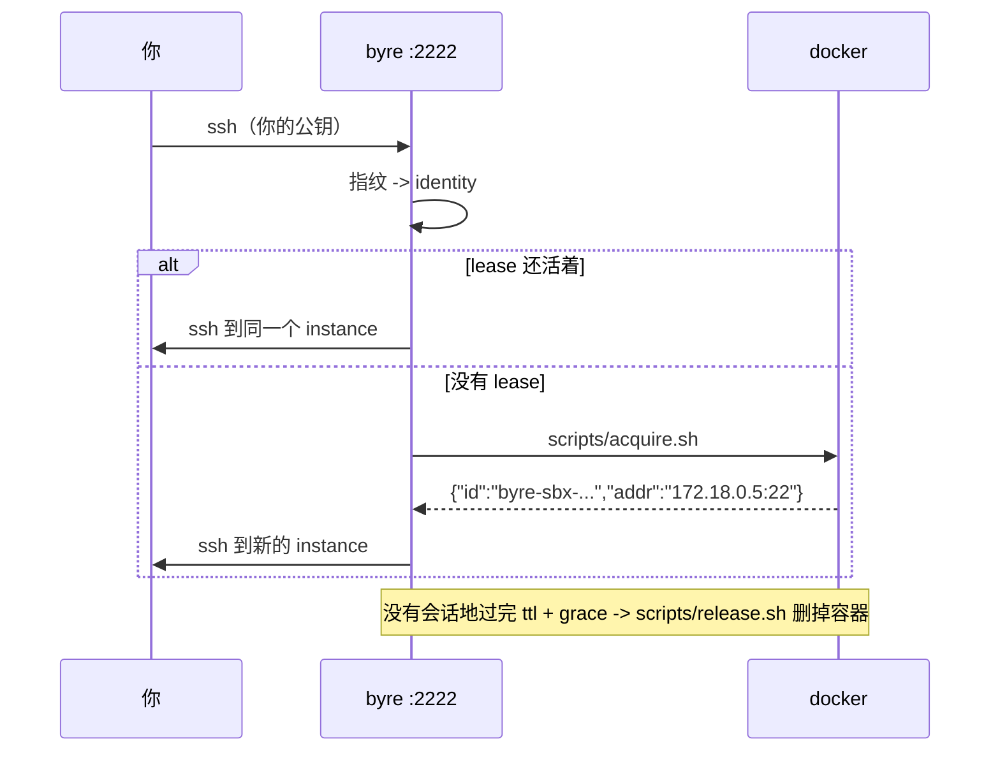

# Docker 起步套件

最小的完整 byre 部署：一个 gateway 进程，sandbox 是普通 docker 容器，没有 Kubernetes。

每把连上来的 SSH 密钥拿到**自己的容器**，持有到 lease TTL，然后释放。两个人同时连，拿到两台不同的主机；同一个人在 TTL 内重连，回到同一台。

## 你需要什么

- `docker`
- `byre` —— 一个 release 二进制，或者 `go build ./cmd/byre`

## 跑起来

```sh
cd examples/docker-sandbox

# 1. 生成 pool 密钥。gateway 留私钥那一半；公钥那一半烤进 sandbox image。
#    不进版本库 —— 见 .gitignore。
./scripts/keys.sh

# 2. 构建 sandbox image。
docker network create byre-example 2>/dev/null || true
docker build -f Dockerfile.sandbox -t byre-sandbox:local .

# 3. 把你自己的密钥指纹填进 byre-config.yaml。
ssh-keygen -lf ~/.ssh/id_ed25519.pub    # SHA256:... -- 粘进 identities[0].fingerprint

# 4. 启动 gateway。
mkdir -p hostkey
byre -config byre-config.yaml
```

以你自己的身份连：

```sh
ssh -p 2222 -i ~/.ssh/id_ed25519 sandbox@127.0.0.1 hostname
```

跑两次。hostname 一样，因为 lease 还活着。等过 `ttl` + `grace` 再连 —— hostname 变了，因为容器被释放、新的起来了。

> 2222 端口被占了的话（git 服务器常常占着），加 `-listen :22022`，连的时候用 `-p 22022`。

## 每条连接发生什么



## 三个脚本

`command` provisioner 是 byre 里唯一知道怎么创建东西的部分。它跑三个程序，从里面读 JSON：

| 脚本 | 何时 | 契约 |
|---|---|---|
| `scripts/acquire.sh` | 某个 identity 需要一个 instance | 打印一个 JSON 对象 `{"id","addr"}`；`$BYRE_IDENTITY` 已设置 |
| `scripts/release.sh` | 一条 lease 结束 | 删掉那个 instance；`$BYRE_INSTANCE_ID` 已设置（不是 `$1`） |
| `scripts/list.sh` | gateway 启动 | 打印一个活着的 instance 的 JSON 数组 |

`acquire` 把指纹记成容器 label（`byre.io.identity`，用点不用斜杠 —— docker 不接受 label key 里的 `/`），`list` 再把它映射回 `annotations."byre.io/identity"`。重启之后 adopt 不 adopt 一个 instance，只看这个 annotation；没有它，instance 就被放着不动，而不是被销毁（ADR-0009）。

把这三个脚本换成任何别的东西 —— `systemd-run`、一个 VM driver、一个云 API —— byre 其余部分不变。

## 容器不是 VM

`acquire.sh` 里有两处，是因为 sandbox 是一次性容器：

- `--cap-drop ALL` 加六个 `--cap-add`：sshd 需要 `SYS_CHROOT`（它 chroot 到 `/var/empty`）、`SETUID`/`SETGID`（变成那个用户）、`CHOWN`/`DAC_OVERRIDE`（读密钥）、`KILL`。别的全丢掉。
- 配置里的 `host_key_policy: insecure`：docker 会复用 IP，所以主机密钥*变了*是正常的。`accept-new` 首次使用时钉住，然后拒绝那个 IP 上的下一个容器。

## 换成 Kubernetes？

见 [`../kubernetes-sandbox`](kubernetes-sandbox.md)：同一个 gateway，同样的配置形状，但 instance 来自 CRD，而这里构建的 image 正是模板要跑的那个。
