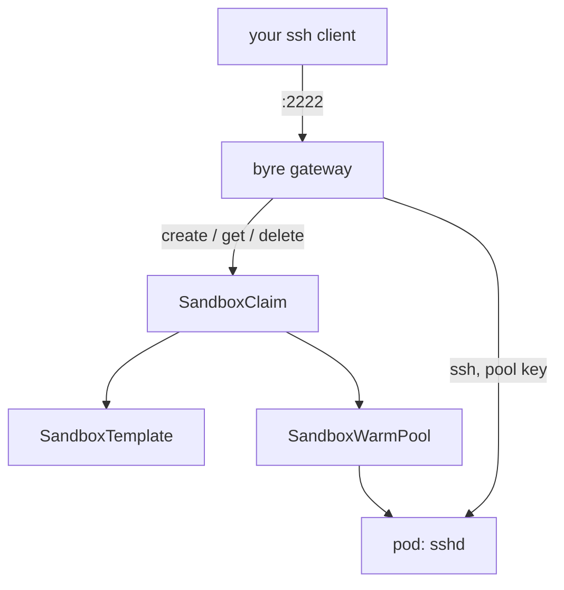

# Kubernetes starter kit

byre in front of a Kubernetes-native sandbox controller. The gateway turns "this SSH key
connected" into "create/extend/release one claim for it"; the controller does the rest.

The controller used here is [`kubernetes-sigs/agent-sandbox`](https://github.com/kubernetes-sigs/agent-sandbox)
(`extensions.agents.x-k8s.io/v1beta1`). byre does not implement it and does not depend on it
in code — the CRD group, version, kind and endpoint field are all configuration, so a
different controller with the same shape works with no rebuild.



## Prerequisites

1. **The lease-table CRD.** `40-byre-config.yaml` sets `lease.store: crd`, so the `ByreLease` kind has
   to exist before the gateway starts:

   ```sh
   kubectl apply -f ../../deploy/crd/byreleases.yaml
   ```

   It is cluster-scoped (the CRD object, not the leases), so this needs the rights to create one.
   Applying it out of the Helm chart instead does the same thing — the chart ships it in `crds/`.
2. **The controller installed.** Its CRDs must serve `SandboxTemplate`, `SandboxWarmPool` and
   `SandboxClaim` in `extensions.agents.x-k8s.io/v1beta1`. One file installs the controller and all
   of them:

   ```sh
   kubectl apply -f https://github.com/kubernetes-sigs/agent-sandbox/releases/latest/download/sandbox-with-extensions.yaml
   kubectl -n agent-sandbox-system rollout status deploy/agent-sandbox-controller
   ```

   Verified against `v1.0.12`: that manifest is the namespace, three CRDs, the controller's RBAC,
   Service and Deployment — 12 objects. `sandbox.yaml` from the same release is the smaller,
   extensions-free variant and does **not** include the `extensions.agents.x-k8s.io` group, so it is
   not the file you want here. Pin a version (`.../download/v1.0.12/...`) if you do not want `latest`
   moving under you.
3. **A sandbox image that runs sshd.** The quickest path is the one from the docker kit:

   ```sh
   docker build -f ../docker-sandbox/Dockerfile.sandbox \
     -t <your-registry>/byre-sandbox:latest ../docker-sandbox
   docker push <your-registry>/byre-sandbox:latest
   ```

   then edit `image:` in `10-sandbox-template.yaml`. Any image with sshd on 22 and the pool
   key in `authorized_keys` works.
4. **A pool key pair.** `../docker-sandbox/scripts/keys.sh` generates one; the gateway keeps
   the private half, the image bakes in the public half.

## Apply

```sh
kubectl create namespace byre

kubectl -n byre create secret generic byre-pool-key \
  --from-file=id_key=../docker-sandbox/keys/id_key

ssh-keygen -lf ~/.ssh/id_ed25519.pub     # SHA256:... -> identities[0].fingerprint in 40-byre-config.yaml
kubectl -n byre create configmap byre-config \
  --from-file=config.yaml=40-byre-config.yaml

kubectl apply -f 10-sandbox-template.yaml
kubectl apply -f 20-sandbox-warmpool.yaml
kubectl apply -f 30-rbac.yaml
kubectl apply -f 50-byre-deployment.yaml

kubectl -n byre port-forward svc/byre 2222:2222
```

Then, from another shell:

```sh
ssh -o StrictHostKeyChecking=no -p 2222 -i ~/.ssh/id_ed25519 sandbox@127.0.0.1 hostname
```

`verify.sh` runs that twice and asserts both land on the same instance.

## What each file does

| file | why it exists |
|---|---|
| `10-sandbox-template.yaml` | the pod spec every sandbox pod gets; `readOnlyRootFilesystem` + memory-backed `/run` because sshd needs nothing else |
| `20-sandbox-warmpool.yaml` | pre-started pods so the first connection is fast |
| `30-rbac.yaml` | a Role that can only create/get/list/watch/delete `sandboxclaims` — not the template, not the pool |
| `40-byre-config.yaml` | `provision: claims` + where the endpoint lives |
| `50-byre-deployment.yaml` | one replica, `Recreate`: leases live in the CRD and agree across copies, but an open SSH session lives in one pod, so replicas need sticky routing |
| `verify.sh` | two connections, one instance |

## Two things that bite

**`sandboxTemplateRef`, not `templateRef`.** The eager form is accepted by
`kubectl --dry-run=server` and then ignored by the controller: the pool starts with zero warm
pods and nothing reports an error.

**`replicas: 0` is meaningful.** It means "no warm capacity, create on demand", not "unset" —
an operator shrinking the pool before rotating the pool key depends on that.

## Using a different controller

Nothing in byre knows the name `SandboxClaim`. To point it at another controller, change only
the `provider:` block in `40-byre-config.yaml`:

```yaml
    provider:
      warm_pool: <pool-object-name>
      api_group: <your.crd.group>
      api_version: <version>
      resource: <plural-resource>            # what the REST path uses: .../sandboxclaims
      object_kind: <Kind>                    # what appears in manifests
      endpoint_field: ["status", "sandbox", "serviceFQDN"]
      ready_timeout: 180s
```

`endpoint_field` is a list of field names, not a template string; the default
`status.sandbox.serviceFQDN` is where the reference controller puts the endpoint. A bare host
is accepted and gets `:22` appended (or whatever `ssh.port` says).

The three requirements on the controller are structural, not API-shaped: the claim object must
be creatable and deletable by byre, its status must expose a resolvable endpoint while it
exists, and the resulting pod must accept the gateway's pool key on the SSH port. Everything
else is convention.

## Publishing

`.github/workflows/release.yml` builds `ghcr.io/<owner>/byre` on a tag push. The sandbox image
is deliberately *not* published by this repository: it is one `FROM alpine` away from anything
you already run, and pinning your own copy beats depending on ours.
