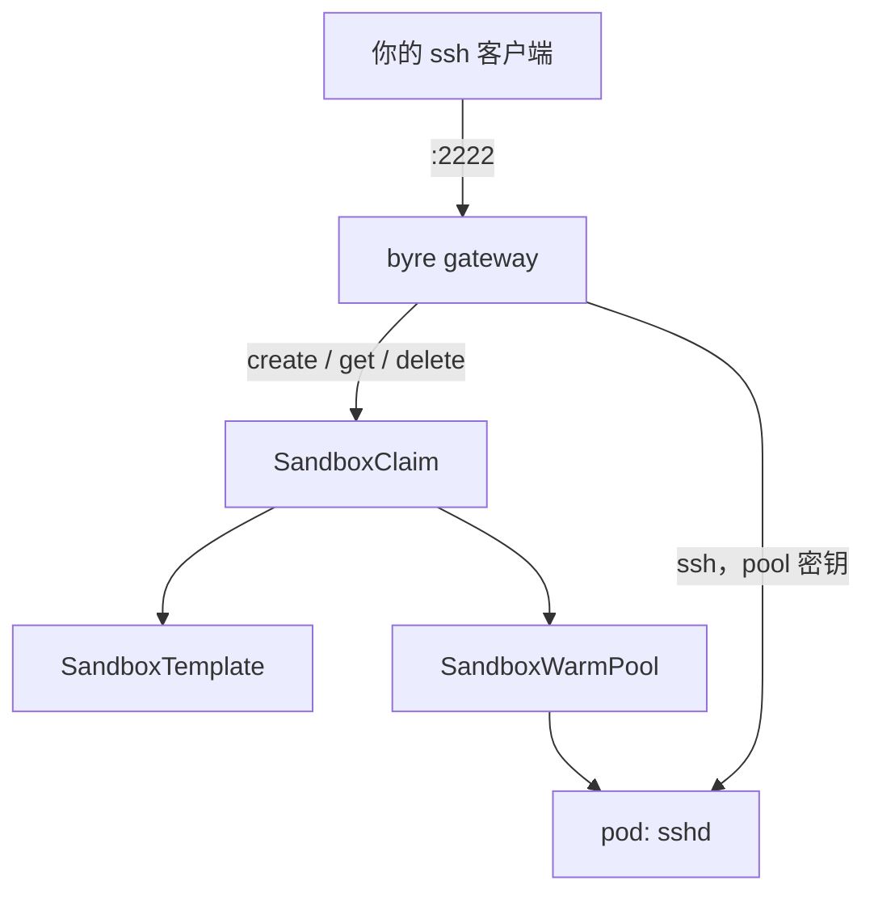

# Kubernetes 起步套件

byre 站在一个 Kubernetes 原生的 sandbox controller 前面。gateway 把"这把 SSH 密钥连上来了"变成"为它 create/extend/release 一个 claim"；剩下的 controller 做。

这里用的 controller 是 [`kubernetes-sigs/agent-sandbox`](https://github.com/kubernetes-sigs/agent-sandbox)
（`extensions.agents.x-k8s.io/v1beta1`）。byre 不实现它，代码里也不依赖它 —— CRD 的 group、version、
kind 和 endpoint 字段全是配置，所以另一个形状相同的 controller 不用重新编译就能用。



## 前置条件

1. **lease 表的 CRD。** `40-byre-config.yaml` 设了 `lease.store: crd`，所以 `ByreLease` 这个 kind 必须在
   gateway 启动前就存在：

   ```sh
   kubectl apply -f ../../deploy/crd/byreleases.yaml
   ```

   它是集群级的（说的是 CRD 对象，不是 lease 本身），所以这需要创建它的权限。
   改用 Helm chart 来 apply 效果一样 —— chart 把它放在 `crds/` 里。
2. **controller 装好。** 它的 CRD 必须在 `extensions.agents.x-k8s.io/v1beta1` 里提供
   `SandboxTemplate`、`SandboxWarmPool` 和 `SandboxClaim`。一个文件装 controller 和它们全部：

   ```sh
   kubectl apply -f https://github.com/kubernetes-sigs/agent-sandbox/releases/latest/download/sandbox-with-extensions.yaml
   kubectl -n agent-sandbox-system rollout status deploy/agent-sandbox-controller
   ```

   对照 `v1.0.12` 验过：那个 manifest 是 namespace、三个 CRD、controller 的 RBAC、
   Service 和 Deployment —— 12 个对象。同一个 release 里的 `sandbox.yaml` 是更小的、不带 extensions
   的变体，**不**包含 `extensions.agents.x-k8s.io` 这个 group，所以不是这里要的文件。不想让 `latest`
   在你脚下移动就钉一个版本（`.../download/v1.0.12/...`）。
3. **一个能跑 sshd 的 sandbox image。** 最快的路是 docker 套件里那个：

   ```sh
   docker build -f ../docker-sandbox/Dockerfile.sandbox \
     -t <your-registry>/byre-sandbox:latest ../docker-sandbox
   docker push <your-registry>/byre-sandbox:latest
   ```

   然后改 `10-sandbox-template.yaml` 里的 `image:`。任何在 22 端口上有 sshd、`authorized_keys`
   里有 pool 密钥的 image 都行。
4. **一对 pool 密钥。** `../docker-sandbox/scripts/keys.sh` 生成一对；gateway 留私钥那一半，
   image 烤进公钥那一半。

## 应用

```sh
kubectl create namespace byre

kubectl -n byre create secret generic byre-pool-key \
  --from-file=id_key=../docker-sandbox/keys/id_key

ssh-keygen -lf ~/.ssh/id_ed25519.pub     # SHA256:... -> identities[0].fingerprint in 40-byre-config.yaml
kubectl -n byre create configmap byre-config \
  --from-file=config.yaml=40-byre-config.yaml

kubectl apply -f 10-sandbox-template.yaml
kubectl apply -f 20-sandbox-warmpool.yaml
kubectl apply -f 30-rbac.yaml
kubectl apply -f 50-byre-deployment.yaml

kubectl -n byre port-forward svc/byre 2222:2222
```

然后，在另一个 shell 里：

```sh
ssh -o StrictHostKeyChecking=no -p 2222 -i ~/.ssh/id_ed25519 sandbox@127.0.0.1 hostname
```

`verify.sh` 跑那条命令两次，并断言两次都落到同一个 instance。

## 每个文件做什么

| 文件 | 为什么存在 |
|---|---|
| `10-sandbox-template.yaml` | 每个 sandbox pod 拿到的 pod spec；`readOnlyRootFilesystem` + 内存支撑的 `/run`，因为 sshd 别的都不要 |
| `20-sandbox-warmpool.yaml` | 预先启动的 pod，让第一条连接快 |
| `30-rbac.yaml` | 一个只能 create/get/list/watch/delete `sandboxclaims` 的 Role —— 不能碰模板，不能碰池 |
| `40-byre-config.yaml` | `provision: claims` + endpoint 在哪 |
| `50-byre-deployment.yaml` | 一个副本，`Recreate`：lease 活在 CRD 里、跨副本一致，但一条打开的 SSH 会话活在一个 pod 里，所以多副本需要粘性路由 |
| `verify.sh` | 两条连接，一个 instance |

## 两处会咬人的地方

**是 `sandboxTemplateRef`，不是 `templateRef`。** 后一种写法会被
`kubectl --dry-run=server` 接受，然后被 controller 忽略：池以零个热 pod 启动，没有任何东西报错。

**`replicas: 0` 是有意义的。** 它表示"没有热容量，按需创建"，不是"未设置" ——
运维在轮转 pool 密钥前把池缩到零，靠的就是这个。

## 用另一个 controller

byre 里没有任何地方认识 `SandboxClaim` 这个名字。要指向另一个 controller，只改
`40-byre-config.yaml` 里的 `provider:` 块：

```yaml
    provider:
      warm_pool: <pool-object-name>
      api_group: <your.crd.group>
      api_version: <version>
      resource: <plural-resource>            # REST 路径用这个：.../sandboxclaims
      object_kind: <Kind>                    # manifest 里出现的名字
      endpoint_field: ["status", "sandbox", "serviceFQDN"]
      ready_timeout: 180s
```

`endpoint_field` 是一串字段名，不是模板字符串；默认的
`status.sandbox.serviceFQDN` 是参考 controller 放 endpoint 的地方。只给一个裸主机名也接受，
会自动补 `:22`（或者 `ssh.port` 说的那个端口）。

对 controller 的三个要求是结构上的，不是 API 形状上的：claim 对象必须能被 byre 创建和删除，
它在存在期间 status 必须暴露一个可解析的 endpoint，产出的 pod 必须在 SSH 端口上接受 gateway
的 pool 密钥。其余都是约定。

## 发布

`.github/workflows/release.yml` 在打 tag 时构建 `ghcr.io/<owner>/byre`。sandbox image 是故意
**不**由这个仓库发布的：它离你已经在跑的任何东西只差一句 `FROM alpine`，钉住你自己的副本
比依赖我们的强。
