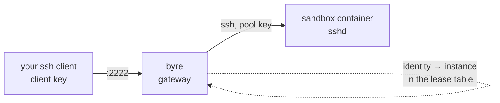

# Five-second start

```sh
./run.sh
```

That is the whole thing. It generates the keys, renders the config, builds a sandbox image, starts
both containers and prints the one `ssh` command you need. Nothing to edit, nothing to fill in.

You need Docker. Nothing else — no Go, no cluster, no controller, no registry login.



## What you are looking at

Three ideas, and the demo exists to show them rather than to be a deployment:

**Identity is the key.** The `identities:` list holds a fingerprint, not a username. A key that is
not in it is refused during authentication — the refusal is indistinguishable from a wrong password,
because telling an unauthorised key that it is unauthorised is a free oracle. Your key was written
into that list by `run.sh`; nothing else can get in.

**The lease is per identity, not per connection.** Connect twice in two terminals: both land on the
same instance. The second connection did not get a second sandbox, because the table is keyed on the
fingerprint. Wait out `ttl: 120s` with nothing connected and the instance is released; the next
connection gets a fresh one. In a real deployment the ttl is hours and the point is that a dropped
connection costs nothing.

**The backend is configuration.** This kit uses `provision: endpoints` — one container that already
exists, leased out and handed back. That is the simplest of the four provisioning shapes and the
only one that provisions nothing. The other kits swap that block for a Docker driver or a Kubernetes
claim controller; the lease logic above it does not change.

## Commands

| command | what it does |
|---|---|
| `./run.sh` | start; reuses keys and the image on later runs |
| `./run.sh status` | containers + the gateway's own log |
| `./run.sh ssh` | connect with the right key and options |
| `./run.sh down` | remove containers, keep `.work/` so the next run is instant |
| `./run.sh clean` | remove `.work/` and the sandbox image too |

Everything generated lands in `.work/` (gitignored): `keys/` (pool key), `client/` (your key),
`config.yaml` (rendered), `sandbox/` (build context).

## Things worth trying

```sh
# The same key, twice, in two windows: same instance.
ssh -o StrictHostKeyChecking=no -o IdentitiesOnly=yes -p 2222 -i .work/client/byre_client sandbox@127.0.0.1 hostname

# A key that is not in identities: refused during auth, no useful error.
ssh-keygen -t ed25519 -N '' -f /tmp/outsider -q
ssh -o StrictHostKeyChecking=no -o IdentitiesOnly=yes -p 2222 -i /tmp/outsider sandbox@127.0.0.1 true
# -> sandbox@127.0.0.1: Permission denied (publickey)

# What the gateway thinks its leases are. There is no API for this: the metrics endpoint is the
# supported view, and the log lines carry the identity → instance decision.
docker logs byre-quickstart 2>&1 | grep -i lease
```

## Where next

- [`../docker-sandbox/`](docker-sandbox.md) — a container **per identity**, provisioned and destroyed
  by the gateway. This is the smallest kit that actually provisions.
- [`../kubernetes-sandbox/`](kubernetes-sandbox.md) — a pod per identity through a claim controller,
  with a warm pool so the first connection is fast.
- [`../local-quickstart/`](local-quickstart.md) — the same `endpoints` idea against a machine you
  already SSH into, no Docker.

## What this is not

The Docker quickstart has no cluster to put a CRD in, so it runs the gateway with
`lease.store: memory`. A restart re-provisions every identity, and an instance deleted behind the
gateway's back keeps its dead address until the ttl expires.

With a cluster, `lease.store: crd` (the shipped default) puts the table in `ByreLease` objects that
survive restarts and are readable with `kubectl get byl`. See
[ADR-0013](../adr/0013-lease-state-in-a-crd.md) for why the table moved and what it cost.
