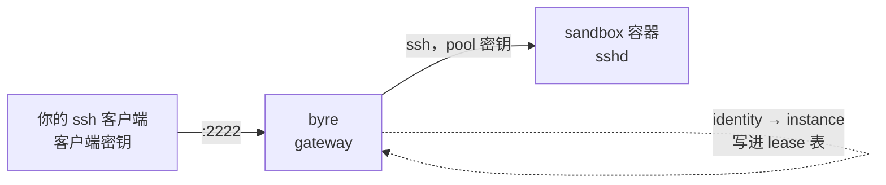

# 五秒上手

```sh
./run.sh
```

就这么回事。它生成密钥、渲染配置、构建 sandbox image、启动两个容器，并打印你需要的那一条 `ssh` 命令。
没有要改的，没有要填的。

你只需要 Docker。别的都不要 —— 不要 Go，不要集群，不要 controller，不要 registry 登录。



## 你在看什么

三个想法，这个 demo 是为了把它们演出来，不是拿来当部署用的：

**identity 就是密钥。** `identities:` 列表里放的是指纹，不是用户名。不在里面的密钥在认证阶段就被拒 ——
这种拒绝跟密码错误分不出来，因为告诉一把未授权的密钥"你未授权"，等于白送一个 oracle。
你的密钥是 `run.sh` 写进那个列表的；别的东西进不来。

**lease 按 identity 算，不按连接算。** 在两个终端里连两次：都落到同一个 instance。第二条连接没有再拿
第二个 sandbox，因为表是按指纹做键的。什么都不连、干等过 `ttl: 120s`，instance 就被释放；
下一条连接拿到一个全新的。真实部署里 ttl 是小时级，重点在于掉一条连接不花任何代价。

**backend 是配置。** 这套件用 `provision: endpoints` —— 一个已经存在的容器，租出去再还回来。
这是四种 provision 形态里最简单的一种，也是唯一一种什么都不 provision 的。其他套件把那一段换成
Docker driver 或 Kubernetes claim controller；它上面的 lease 逻辑一个字不用改。

## 命令

| 命令 | 做什么 |
|---|---|
| `./run.sh` | 启动；之后再跑会复用密钥和 image |
| `./run.sh status` | 容器 + gateway 自己的日志 |
| `./run.sh ssh` | 用对的密钥和选项连上去 |
| `./run.sh down` | 删掉容器，保留 `.work/`，下次跑是瞬时的 |
| `./run.sh clean` | 连 `.work/` 和 sandbox image 一起删掉 |

生成的东西都落在 `.work/`（已 gitignore）：`keys/`（pool 密钥）、`client/`（你的密钥）、
`config.yaml`（渲染后的）、`sandbox/`（构建上下文）。

## 值得一试

```sh
# 同一把密钥，两个窗口，连两次：同一个 instance。
ssh -o StrictHostKeyChecking=no -o IdentitiesOnly=yes -p 2222 -i .work/client/byre_client sandbox@127.0.0.1 hostname

# 一把不在 identities 里的密钥：认证阶段被拒，没有有用的报错。
ssh-keygen -t ed25519 -N '' -f /tmp/outsider -q
ssh -o StrictHostKeyChecking=no -o IdentitiesOnly=yes -p 2222 -i /tmp/outsider sandbox@127.0.0.1 true
# -> sandbox@127.0.0.1: Permission denied (publickey)

# gateway 认为自己的 lease 是什么样。没有 API 可查：metrics 端点是受支持的视图，
# 日志行里带着 identity → instance 的决定。
docker logs byre-quickstart 2>&1 | grep -i lease
```

## 接下来

- [`../docker-sandbox/`](docker-sandbox.md) —— 每个 identity 一个容器，由 gateway provision、
  由 gateway 销毁。这是真正会 provision 东西的最小套件。
- [`../kubernetes-sandbox/`](kubernetes-sandbox.md) —— 每个 identity 一个 pod，走 claim controller，
  带热池，所以第一条连接很快。
- [`../local-quickstart/`](local-quickstart.md) —— 同样的 `endpoints` 思路，对着你本来就能 SSH
  进去的机器，不用 Docker。

## 这不是什么

Docker quickstart 没有集群可以放 CRD，所以它用 `lease.store: memory` 跑 gateway。
重启会给每个 identity 重新 provision，而绕过 gateway 删掉的 instance 会一直占着它那个死地址，
直到 ttl 过期。

有集群的话，`lease.store: crd`（出厂默认）把表放进 `ByreLease` 对象，能熬过重启，
用 `kubectl get byl` 就能读。表为什么搬了家、代价是什么，见
[ADR-0013](../adr/0013-lease-state-in-a-crd.md)。
