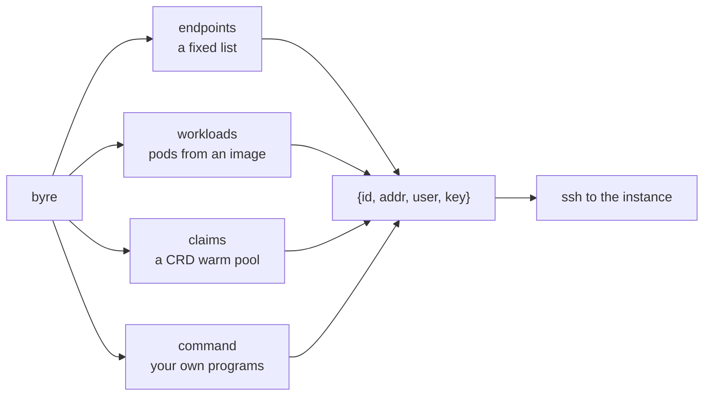

# Choose a backend

byre never creates instances itself. It asks a **backend** for an instance and gets back an
`{id, addr, user, key}` record, so everything about *reaching* an instance over SSH is shared. There are
four ways a backend can come by one.

| shape | an instance is… | survives a gateway restart | cluster needed | verified on a cluster |
|---|---|---|---|---|
| `endpoints` | one entry from a list you wrote | **no** — assignment is in memory | no | no |
| `workloads` | a pod created from an image | yes (identity is written on the pod) | yes | no |
| `claims` | a claim against a `SandboxTemplate` + `SandboxWarmPool` | yes (identity is written on the claim) | yes | **yes** |
| `command` | whatever your program returns | depends on your `list` output | no | no |

**Start with `endpoints` if you have machines already.** It is the shortest path to a working gateway and
needs no cluster. The cost is that a restart forgets which identity had which host, so a reconnecting
client may land elsewhere — the one property the project exists to provide. That is fine for a lab and
wrong for an agent doing multi-step work.

**`claims` is the shape this project was built for.** It is also the only one with recorded cluster runs
. Warm capacity means the first connection is fast, and the identity lives on
the claim, so a restarted gateway re-adopts live leases instead of handing out fresh sandboxes.
See [Kubernetes](kubernetes.md) for the end-to-end recipe.

**`command` is the escape hatch.** Four programs — `acquire`, `release`, `list`, and optionally `env` — in
any language. Anything that can print an endpoint can be a backend, which is how the Docker variant works
without a cluster: `examples/docker-sandbox/` drives containers through shell scripts.

One rule that bites: **`acquire` and `list` must agree on the identity annotation.** `acquire` prints the
identity onto the instance; `list` has to report it back, or a restart adopts nothing and the instance is
listed but never matched to the client that reconnects. Printing it in one and not the other is the most
common way to build a backend that works until the first restart.

## Full field reference

Every field of every shape, the readiness rule each one uses, and the exact `command` contract are in
[Backends in detail](../handbook/backends.md). This page is only the "which one do I pick".
