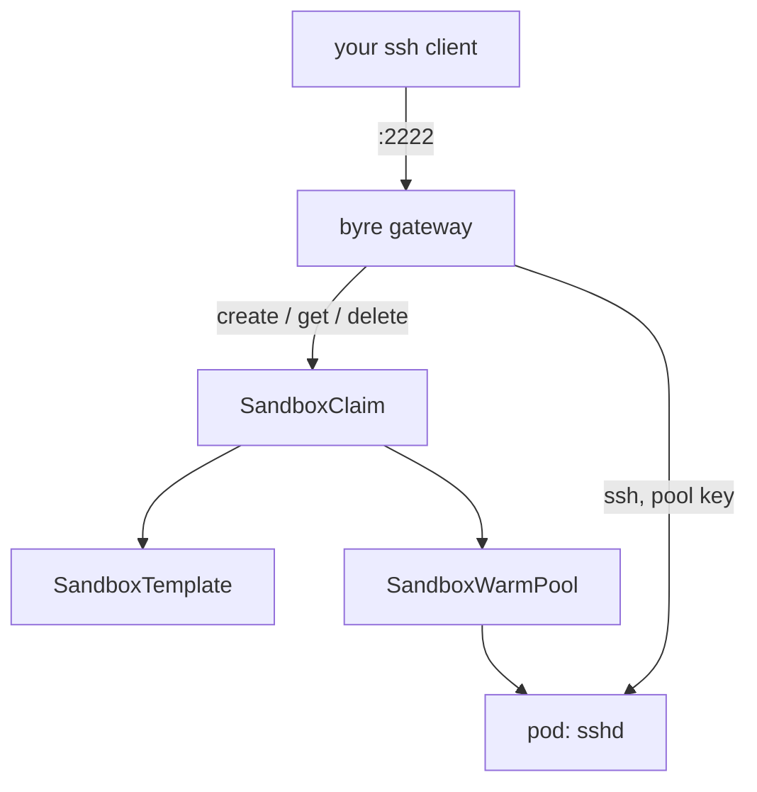

# Kubernetes: sandboxes created on demand

Two independent pieces run here, and they fail separately:

- a **sandbox controller** that knows how to create pods from a template and keep a warm pool, and
- **byre**, which turns "this SSH key connected" into "create / extend / release one claim for it".

byre does not implement the controller and does not link against it. The CRD group, version, kind and
endpoint field are configuration, so any controller with the same shape works without a rebuild. The
reference one is [`kubernetes-sigs/agent-sandbox`](https://github.com/kubernetes-sigs/agent-sandbox).



## Prerequisites

| what | why |
|---|---|
| Kubernetes **1.29+** | the controller's CRDs use CEL validation rules; 1.25–1.28 need a feature gate, and 1.29 has them stable |
| `kubectl` | both halves are installed with it |
| a container registry you can push to | the sandbox image has to be pullable from the cluster |
| `helm` (optional) | only if you take the chart route; the plain-YAML route needs nothing but `kubectl` |

## Step 1 — install the sandbox controller

**This step is the one people skip, and skipping it is not silent in a helpful way**: applying
`SandboxTemplate` without the controller gives `no matches for kind "SandboxTemplate"`, but byre itself
still starts and reports healthy, so it looks like a byre problem.

```sh
# latest release
kubectl apply -f https://github.com/kubernetes-sigs/agent-sandbox/releases/latest/download/sandbox-with-extensions.yaml

# or pin a version (recommended outside a lab)
export VERSION="v1.0.2"
kubectl apply -f https://github.com/kubernetes-sigs/agent-sandbox/releases/download/${VERSION}/sandbox-with-extensions.yaml
```

Verify the CRDs are served before going further:

```sh
kubectl get crd | grep agents.x-k8s.io
# expect at least: sandboxclaims, sandboxes, sandboxtemplates, sandboxwarmpools
kubectl -n agent-sandbox-system rollout status deploy --timeout=120s
```

## Step 2 — build and push a sandbox image

The image needs exactly one thing: `sshd` on port 22 accepting the pool key. The repository's docker kit
is one `FROM alpine` away from that:

```sh
git clone https://github.com/xiyuera/byre && cd byre/examples/docker-sandbox
./scripts/keys.sh                                  # generates keys/id_key and keys/id_key.pub
docker build -f Dockerfile.sandbox -t <your-registry>/byre-sandbox:latest .
docker push <your-registry>/byre-sandbox:latest
```

That image bakes the **public** half into `authorized_keys`. The gateway keeps the private half and uses it
as `ssh.privateKey`. Two different keys are in play and mixing them up is the most common mistake:

| key | who holds it | what it proves |
|---|---|---|
| **client key** | you / your agent | which identity is asking. Its fingerprint goes in `identities[].fingerprint`. |
| **pool key** | the gateway | that the gateway may log in to instances. Its private half lives in a Secret; its public half is in the image. |

## Step 3 — install byre

### Option A: plain YAML (5 files, no Helm)

```sh
cd examples/kubernetes-sandbox
kubectl create namespace byre

kubectl -n byre create secret generic byre-pool-key \
  --from-file=id_key=../docker-sandbox/keys/id_key

# put your client key's fingerprint into 40-byre-config.yaml first
ssh-keygen -lf ~/.ssh/id_ed25519.pub -E sha256

# point 10-sandbox-template.yaml at the image you pushed in step 2
kubectl apply -f 10-sandbox-template.yaml
kubectl apply -f 20-sandbox-warmpool.yaml
kubectl apply -f 30-rbac.yaml
kubectl -n byre create configmap byre-config --from-file=config.yaml=40-byre-config.yaml
kubectl apply -f 50-byre-deployment.yaml
```

### Option B: Helm

```sh
helm install byre ./charts/byre -n byre --create-namespace \
  --set sandbox.enabled=true \
  --set sandbox.image.repository=<your-registry>/byre-sandbox \
  --set sandbox.image.tag=latest \
  --set poolKey.existingSecret=byre-pool-key \
  --set-json 'identities=[{"fingerprint":"SHA256:...","backend":"sandbox"}]'
```

Two things about the chart that are easy to trip over:

- **`sandbox.enabled` defaults to `false`.** The chart ships a placeholder image
  (`ghcr.io/example/byre-sandbox`) that does not exist, so turning the sandbox half on by default would
  leave a warm pool `Pending` with no obvious cause. Turn it on *after* step 2.
- **The chart does not install the `ByreLease` CRD.** It lives at `deploy/crd/byreleases.yaml` and has to
  be applied separately with cluster-level rights. You only need it if you set `lease.store=crd`; the
  in-memory default works without it. Note that `lease.store` is not exposed as a chart value yet — see
  [Operations](../handbook/operations.md).

## Step 4 — connect

```sh
kubectl -n byre port-forward svc/byre 2222:2222 &
ssh -o StrictHostKeyChecking=no -p 2222 -i ~/.ssh/id_ed25519 sandbox@127.0.0.1 hostname
ssh -o StrictHostKeyChecking=no -p 2222 -i ~/.ssh/id_ed25519 sandbox@127.0.0.1 hostname
```

**Both commands must print the same hostname.** That is the whole product: two connections, one instance.
If they differ, the identity did not match — check that the fingerprint in `identities[]` is the *client*
key's, not the pool key's.

`examples/kubernetes-sandbox/verify.sh` runs exactly this assertion.

## What each object is for

| object | why it exists |
|---|---|
| `SandboxTemplate` | the pod spec every sandbox gets. `readOnlyRootFilesystem` plus a memory-backed `/run` because sshd needs nothing else. |
| `SandboxWarmPool` | pre-started pods so the first connection is fast. `replicas: 0` means "no warm capacity, create on demand", not "unset". |
| `SandboxClaim` | byre creates one per identity and deletes it when the lease ends. |
| RBAC `Role` | lets byre create/get/list/watch/delete `sandboxclaims` only — not the template, not the pool. |

## Sizing

Each sandbox is a real pod. The pool is the thing that surprises people:

- `SandboxWarmPool.replicas` warm pods exist **in addition to** leased ones, so `replicas: 2` with 6
  identities means up to 8 pods.
- Warm capacity is what makes a first connection fast. With an empty pool, concurrent first connections
  race the controller: the pod is not `Ready` yet but the claim exists, and a connection that arrives in
  that window is closed. Retrying succeeds. Raising `replicas` above your expected concurrent first
  connections avoids it.
- Node choice is not byre's decision. If some nodes are much faster than others, use
  `nodeSelector`/`affinity` on the `SandboxTemplate` — otherwise an identity can land on a slow node and
  stay there for the whole lease.
