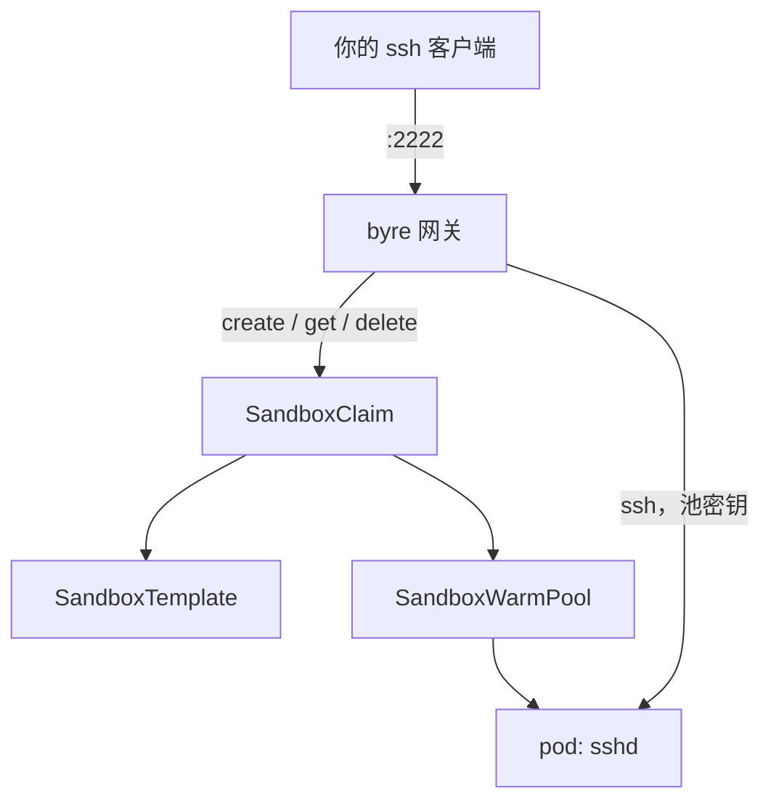

# Kubernetes：按需创建 sandbox

这里跑着两个互相独立的部件，它们也各自独立地坏：

- 一个 **sandbox controller**，知道怎么从模板创建 pod 并维持一个热池；
- **byre**，把「这把 SSH 密钥连进来了」变成「为它创建 / 延长 / 释放一个 claim」。

byre 不实现这个 controller，也不链接它。CRD 的 group、version、kind 和 endpoint 字段都是配置，所以任何形状相同的 controller 都不用重新编译就能用。参考实现是 [`kubernetes-sigs/agent-sandbox`](https://github.com/kubernetes-sigs/agent-sandbox)。



## 前置条件

| 需要 | 为什么 |
|---|---|
| Kubernetes **1.29+** | controller 的 CRD 用了 CEL 校验规则；1.25–1.28 需要开 feature gate，1.29 起这些规则是稳定的 |
| `kubectl` | 两半都用它装 |
| 一个你能推的镜像仓库 | sandbox 镜像必须能从集群里拉得到 |
| `helm`（可选） | 只有走 chart 路线才需要；纯 YAML 路线除 `kubectl` 外什么都不需要 |

## 第 1 步——安装 sandbox controller

**这一步是最多人跳过的，而跳过它并不会以有用的方式静默**：没有 controller 时应用 `SandboxTemplate` 会报 `no matches for kind "SandboxTemplate"`，但 byre 本身照样起得来、也照样报健康，于是看起来像 byre 的问题。

```sh
# 最新版本
kubectl apply -f https://github.com/kubernetes-sigs/agent-sandbox/releases/latest/download/sandbox-with-extensions.yaml

# 或者钉一个版本（实验室之外推荐这么做）
export VERSION="v1.0.2"
kubectl apply -f https://github.com/kubernetes-sigs/agent-sandbox/releases/download/${VERSION}/sandbox-with-extensions.yaml
```

继续往下之前先确认这些 CRD 已经被提供：

```sh
kubectl get crd | grep agents.x-k8s.io
# 至少应有：sandboxclaims, sandboxes, sandboxtemplates, sandboxwarmpools
kubectl -n agent-sandbox-system rollout status deploy --timeout=120s
```

## 第 2 步——构建并推送一个 sandbox 镜像

镜像只需要一样东西：22 端口上接受池密钥的 `sshd`。仓库里的 docker 套件离这个只差一个 `FROM alpine`：

```sh
git clone https://github.com/xiyuera/byre && cd byre/examples/docker-sandbox
./scripts/keys.sh                                  # 生成 keys/id_key 与 keys/id_key.pub
docker build -f Dockerfile.sandbox -t <your-registry>/byre-sandbox:latest .
docker push <your-registry>/byre-sandbox:latest
```

那个镜像把**公钥**那一半烤进 `authorized_keys`。网关留着私钥那一半，作为 `ssh.privateKey` 使用。这里有两把不同的密钥在起作用，把它们弄混是最常见的错误：

| 密钥 | 谁持有 | 它证明什么 |
|---|---|---|
| **客户端密钥** | 你 / 你的 agent | 是哪个 identity 在请求。它的指纹写进 `identities[].fingerprint`。 |
| **池密钥** | 网关 | 网关有权登录 instance。它的私钥放在 Secret 里，公钥在镜像里。 |

## 第 3 步——安装 byre

### 方案 A：纯 YAML（5 个文件，不用 Helm）

```sh
cd examples/kubernetes-sandbox
kubectl create namespace byre

kubectl -n byre create secret generic byre-pool-key \
  --from-file=id_key=../docker-sandbox/keys/id_key

# 先把你的客户端密钥指纹填进 40-byre-config.yaml
ssh-keygen -lf ~/.ssh/id_ed25519.pub -E sha256

# 让 10-sandbox-template.yaml 指向你在第 2 步推上去的镜像
kubectl apply -f 10-sandbox-template.yaml
kubectl apply -f 20-sandbox-warmpool.yaml
kubectl apply -f 30-rbac.yaml
kubectl -n byre create configmap byre-config --from-file=config.yaml=40-byre-config.yaml
kubectl apply -f 50-byre-deployment.yaml
```

### 方案 B：Helm

```sh
helm install byre ./charts/byre -n byre --create-namespace \
  --set sandbox.enabled=true \
  --set sandbox.image.repository=<your-registry>/byre-sandbox \
  --set sandbox.image.tag=latest \
  --set poolKey.existingSecret=byre-pool-key \
  --set-json 'identities=[{"fingerprint":"SHA256:...","backend":"sandbox"}]'
```

关于这个 chart，有两件事很容易踩：

- **`sandbox.enabled` 默认是 `false`。** chart 里带的是一个不存在的占位镜像（`ghcr.io/example/byre-sandbox`），所以默认把 sandbox 那一半打开会让热池一直 `Pending` 而看不出原因。在第 2 步**之后**再打开它。
- **chart 不安装 `ByreLease` CRD。** 它在 `deploy/crd/byreleases.yaml`，得用集群级权限单独应用。只有你把 `lease.store=crd` 时才需要它；默认的内存存储不需要。注意 `lease.store` 目前还没有作为 chart value 暴露——见[运维](../handbook/operations.md)。

## 第 4 步——连接

```sh
kubectl -n byre port-forward svc/byre 2222:2222 &
ssh -o StrictHostKeyChecking=no -p 2222 -i ~/.ssh/id_ed25519 sandbox@127.0.0.1 hostname
ssh -o StrictHostKeyChecking=no -p 2222 -i ~/.ssh/id_ed25519 sandbox@127.0.0.1 hostname
```

**两条命令必须打印同一个 hostname。** 这就是整个产品：两条连接，一个 instance。如果不一样，说明 identity 没匹配上——检查 `identities[]` 里的指纹是**客户端**密钥的，不是池密钥的。

`examples/kubernetes-sandbox/verify.sh` 跑的正好就是这个断言。

## 每个对象是干什么用的

| 对象 | 为什么存在 |
|---|---|
| `SandboxTemplate` | 每个 sandbox 用的 pod spec。`readOnlyRootFilesystem` 加一个内存支撑的 `/run`，因为 sshd 不需要别的。 |
| `SandboxWarmPool` | 提前起好的 pod，让第一次连接快。`replicas: 0` 的意思是「没有热容量，按需创建」，不是「未设置」。 |
| `SandboxClaim` | byre 为每个 identity 创建一个，lease 结束时删掉。 |
| RBAC `Role` | 只让 byre 对 `sandboxclaims` 做 create/get/list/watch/delete——不包括 template，也不包括 pool。 |

## 容量

每个 sandbox 都是一个真的 pod。让人意外的是池：

- `SandboxWarmPool.replicas` 的热 pod 是**额外**存在于被租用的 pod 之外的，所以 `replicas: 2` 加上 6 个 identity 最多是 8 个 pod。
- 热容量是让第一次连接变快的原因。池空的时候，并发的首次连接会和 controller 抢跑：pod 还没 `Ready` 但 claim 已经存在，落在这个窗口里的连接会被关掉。重试就会成功。把 `replicas` 提到你预期的并发首次连接数之上可以避免这件事。
- 落在哪个节点不是 byre 决定的。如果有些节点明显更快，在 `SandboxTemplate` 上用 `nodeSelector`/`affinity`——否则一个 identity 可能落在慢节点上，并整个 lease 都待在那儿。
