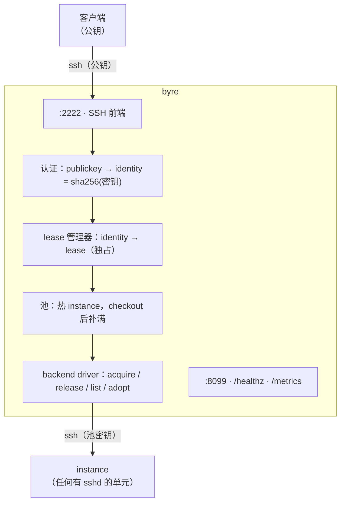
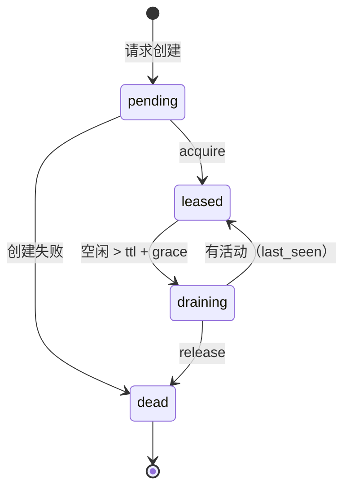

# 架构

## 1. 形状



两个监听器，没有持久化，没有外部服务。状态活在内存里，加上 instance 上的 annotation。

## 2. 连接处理

1. 前端接受一条连接并完成 SSH 握手，只提供一种认证方式：`publickey`。
2. 成功后它算出 `identity = sha256(marshaled public key)`，向 lease 管理器要一个 lease。管理器要么返回这个 identity 现有的 lease，要么从池里取一个 instance，要么让 backend 创建一个。
3. 网关用 backend 的 `ssh` 设置和池密钥，自己开一条到 instance 的 SSH 客户端连接，然后对接：
   - `session`（pty-req、shell、exec）↔ instance 的 session，
   - `direct-tcpip`（`ssh -L`）↔ instance 的 `direct-tcpip`，
   - `tcpip-forward`/`forwarded-tcpip`（`ssh -R`）↔ instance 的远程转发。
4. 断开后 lease 继续存活但空闲；`last_seen` 在每一帧上刷新。回收发生在 `ttl` + `grace` 之后（ADR-0002）。

channel 建立之后的对接是字节级的：不检查载荷的协议，不重新编码。

## 3. lease 状态



- `pending` 是 instance 正在被创建期间存在的那一行。同一个 identity 的第二条连接会等它并加入结果，而不是再发起一次创建。
- `idle` 是 `leased` 的一种状态：`refs == 0` 但还没过期的 lease。池成员不是 lease；它们是有待变成 lease 的热容量。
- `draining` 在 `ttl` + `grace` 已经过去时开始，或者在拨号失败后发现 instance 已经不在了时开始。这一行会被留着——标记，而不是删除——直到 backend 已经销毁了 instance：先删会让一条重连穿透到一个即将消失的 instance 上。在拆除期间到达的连接会等它结束，然后拿到一个新 instance。
- 这张表只有一把互斥锁，只在更新 map 和字段时持有。持锁期间不做任何 backend 调用（`Acquire`、`Bind`、`Release`），所以一个慢 backend 只会让正在等的那个 identity 付出代价，不影响别人。实测到的缺陷、备选方案和后果见 ADR-0012。

## 4. 恢复

启动时——在预热池**之前**——管理器列出每个 driver 拥有的所有 instance（`app.kubernetes.io/managed-by=byre`），并从 `byre.io/identity` annotation 重建 identity 表。没有这个 annotation 的 instance 是上一个进程的热容量：它们会被销毁、池被补满，所以重启永远不会累积孤儿。

让这套机制成立的有两个性质，另有一条刻意的限制：

- 池里的 instance 在交给某个 identity 的那一刻就被 bind（`backend.Binder`），所以对象在任何一个客户端使用它之前就带着 identity；
- 一次失败的 bind 会把 instance 还给 driver，而不是泄漏它；
- 被接管的 lease 是幂等重入的，所以客户端的下一条连接拿到同一个 instance——而一个已经死掉的客户端会被正常的 `ttl` 时钟收走。

## 5. backend

| `provision` | driver | 获取 | 释放 |
|---|---|---|---|
| `claims` | kubernetes | 用配置的 GVK 从 `provider.template` 和/或 `provider.warm_pool` 创建一个对象，然后等到它通告的某个地址（先 `endpoint_field`，再 `podIPs`）以一个完整的 SSH banner 应答 | 删除该对象 |
| `workloads` | kubernetes | 从 `provider.image`（加 `start_command`）创建一个 pod 并等它就绪 | 删除该 pod |
| `endpoints` | static | 从 `endpoints` 里挑一个（轮询，已被租用则跳过） | 标记为空闲 |
| `command` | command | 跑 `command.acquire`；这个程序打印一个描述 instance 的 JSON 对象 | 跑 `command.release` |

这四个就是全部词汇（ADR-0007）。不同基础设施之间差别在于一个 SSH endpoint 怎么产生、怎么销毁，而不在于怎么连上它：`ssh.user`、`ssh.private_key`、`ssh.host_key_policy` 和就绪超时由四种共有，都在 provision 块之外。（`ssh.port` 为了兼容而被接受，但没有 driver 会读它：端口随 instance 的 `addr` 走，或者写在每条 `endpoints` 里。）没有任何一个值指向某个具体产品。像 `extensions.agents.x-k8s.io` 的 `SandboxClaim` 这种 claim 形状的 API，是运维写进 `api_group`/`resource`/`object_kind` 的东西；它不是内置的。

driver 接口是刻意做小的：

```go
type Backend interface {
    Acquire(ctx context.Context, id Identity) (Instance, error)
    Release(ctx context.Context, in Instance) error
    List(ctx context.Context) ([]Instance, error)
    Adopt(ctx context.Context, in []Instance) error
}
```

`Instance` 就是 `{ID, Addr, User, PrivateKey, HostKeyPolicy, Annotations}`——没有任何 backend 特有的东西往上漏。

能提前创建容量的 driver 还要实现 `lease.Pooler`（`Create(ctx)`）；lease 管理器为它维持 `pool_size` 个热 instance，并在每次 checkout 后补满。没有 `Create` 的 driver（`endpoints` 那个）就是没有池——获取一直接在按需路径上，对于本来就存在的机器，这是诚实的模型。

## 6. 失败行为

| 故障 | 行为 |
|---|---|
| instance 在会话中途死掉 | channel 关闭；lease 作废；下一条连接拿到一个全新的 instance |
| backend API 不可达 | acquire 带类型化错误快速失败；客户端看到一次干净的断开并重试 |
| 池耗尽 | acquire 按需创建一个 instance（不排队） |
| 网关重启 | 启动时接管/过期（第 4 节） |
| 配置不合法 | 进程在绑定端口之前退出，并列出所有违规项 |

## 7. 为什么那些看起来显然的替代方案都不成立 {#7-why-the-obvious-alternatives-do-not-work}

这个设计的主张——按 identity 分配，而不是按连接分配——只有当那些更便宜的做法确实失败时，才值得这些代码。其中四种足够显然，下一个读到这里的人大概都想过。

### 用源地址区分

地址标识的是网络，不是客户端。NAT 后面同一台笔记本上的每个 agent 共用它，于是两个 agent 变成一个 identity；NAT 还可能在空闲之后重编号端口映射，于是在 t+0s 能标识客户端的那条地址，在 t+5min 谁也标识不了。从地址猜「是不是同一个客户端」的网关，等于在猜一个由客户端所在网络改写的东西。

### 按 SSH session 分配

根本没有可依托的 session：session 标识由承载它的连接创建。网关终结 SSH，所以它能观察到的唯一 session 就是它刚创建的那个——恰好是断开时被销毁的对象。重连、`scp`、每一条 `-L` 转发，按协议设计都是带新 session 的新连接。

### 连接断开就销毁 instance

这是按连接提供容器的 backend 会做的事，而且它是自洽的：instance 的生命周期就是连接的生命周期。它同时意味着状态在连接之间无处安放，而那正是整个问题。它适合交互式 shell，不适合由一串连接构成的任务。

### 要求客户端保持一条连接不关（`ControlMaster`）

这在 `ControlPersist` 过期之前有效——而那次过期恰好就是设计必须扛住的那次重连。它还把正确性变成了客户端配置：任何不这么做的客户端，或者像参考客户端那样为 `scp` 开一条普通 socket 的客户端，都会静默坏掉。把一条硬性要求推给调用方，正是网关背上一个它看不见的支持负担的方式。

### 那个也不便宜的

按公钥分配把访问控制搬到了密钥分发上：共用一把密钥就是共用一个 instance，轮换密钥就是一个冷启动的新 identity。那是真实的代价，是刻意付的，而且它列在 README 的限制里，而不是藏在这里。

## 8. v1 的非目标

多副本协调、动态 backend 选择、持久状态、按 identity 的配额、UI。annotation 方案和 identity 表的形状都是为了让协调以后能加上去，而不必改变客户端契约。
