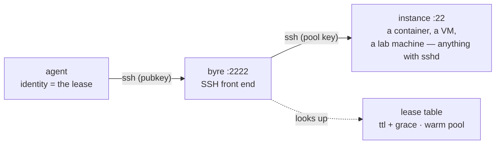

# byre

**The SSH gateway for agent sandboxes.** The client's public key *is* the lease: one agent keeps one
instance exclusively until the lease expires.

**English** · **中文**

[Start in 30 seconds](getting-started/quickstart.md){ .md-button .md-button--primary }
[Read the design](handbook/architecture.md){ .md-button }
[GitHub](https://github.com/xiyuera/byre){ .md-button }

---

## The problem it solves

An agent that syncs a working tree, builds, copies the artefact back and holds a port forward is one task
spread across four SSH connections. A plain jump host hands each connection to whatever instance is free,
so the second command lands somewhere else and every individual command *succeeds* — the agent's bookkeeping
describes one filesystem while it has actually been given four.

byre keys allocation on the one identifier SSH already verifies: the public key the client proved it holds.
That is the identity, and the lease hangs off it.



## What you get

| | |
|---|---|
| **Identity is the key** | No token to remember, no control master to hold open. The key the client already authenticates with is the address. |
| **Leases, not connections** | Idle time ends the lease: after `ttl` plus `grace` the instance returns to the pool. Reconnects inside the grace window find the same machine. |
| **Four provisioning shapes** | `endpoints` (a fixed list), `workloads` (pods from an image), `claims` (a CRD warm pool), `command` (your own acquire/release/list programs). Pick per backend. |
| **Survives a restart** | The Kubernetes backends write the identity onto each instance as an annotation, so a new process re-adopts live leases before it warms anything. Lease state can optionally live in a CRD instead of memory. |

## Thirty seconds, with Docker

No Go, no cluster, nothing to edit:

```sh
git clone https://github.com/xiyuera/byre && cd byre/examples/quickstart
./run.sh
```

It generates the keys, renders the config, builds a sandbox image, starts both containers and prints the
one `ssh` command you need. Connect twice and you get the same instance; wait out the 120s ttl and it is
released.

## Pick your path

| you want | start here | cluster needed |
|---|---|---|
| To see it work in 30 seconds | [Quick start](getting-started/quickstart.md) | no |
| A gateway in front of machines you already have | [Choose a backend](getting-started/backends.md) | no |
| Sandboxes created on demand in Kubernetes | [Kubernetes](getting-started/kubernetes.md) | yes |
| To read the design before trusting it | [Architecture](handbook/architecture.md) | — |

## Status

Pre-1.0. Identity, lease, warm pool and adoption across restarts are verified on a real cluster
; of the four provisioning shapes only `claims` has a cluster run.
Single replica, and no automated end-to-end gate — the cluster runs were executed by hand.
[Limits](limits.md) lists what is deliberately absent, including why one replica is a hard constraint.

Apache-2.0. Renamed from `keypod` — not affiliated with any same-named project, and the licence grants no
trademark rights.
