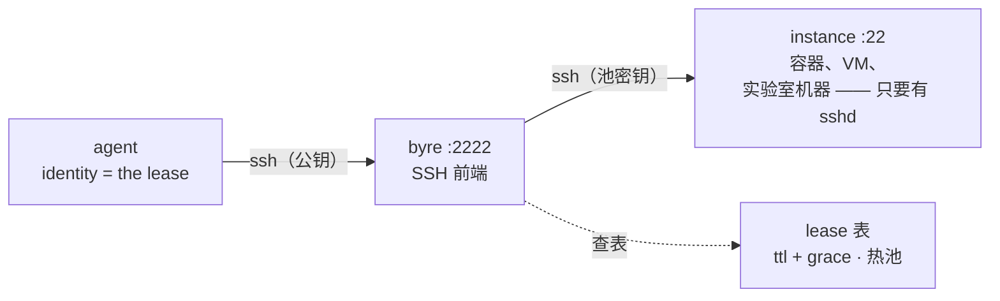

# byre

**面向 agent sandbox 的 SSH 网关。** 客户端的公钥**就是** lease：一个 agent 独占一个 instance，直到 lease 过期。

**English** · **中文**

[30 秒上手](getting-started/quickstart.md){ .md-button .md-button--primary }
[读设计](handbook/architecture.md){ .md-button }
[GitHub](https://github.com/xiyuera/byre){ .md-button }

---

## 它解决什么问题

一个 agent 同步工作树、构建、把产物拷回来、再挂一个端口转发——这是同一个任务分散在四条 SSH 连接上。普通跳板机会把每条连接交给任意空闲的 instance，于是第二条命令落在别处，而每条命令**各自都成功**——agent 的账本描述着一个文件系统，它实际拿到的是四个。

byre 把分配绑定在 SSH 本来就会校验的那个标识上：客户端证明自己持有的公钥。这个标识就是 identity，lease 挂在它上面。



## 你能得到什么

| | |
|---|---|
| **identity 就是密钥** | 没有要记的 token，没有要保持打开的 control master。客户端本来就用它认证的那把密钥，就是它的地址。 |
| **lease，不是连接** | 空闲时间结束 lease：`ttl` 加 `grace` 之后 instance 回到池里。在 grace 窗口内重连，拿到的是同一台机器。 |
| **四种 provision 形态** | `endpoints`（一张固定列表）、`workloads`（从镜像起 pod）、`claims`（CRD 热池）、`command`（你自己的 acquire/release/list 程序）。按 backend 选。 |
| **扛得住重启** | Kubernetes 系 backend 把 identity 作为 annotation 写在每个 instance 上，所以新进程会先接管存活的 lease，再去预热。lease 状态也可以放在 CRD 里而不是内存里。 |

## 三十秒，用 Docker

不需要 Go、不需要集群、什么都不用改：

```sh
git clone https://github.com/xiyuera/byre && cd byre/examples/quickstart
./run.sh
```

它生成密钥、渲染配置、构建 sandbox 镜像、把两个容器起起来，然后打印你需要的那一条 `ssh` 命令。连两次拿到同一个 instance；等过 120 秒的 ttl，它就被释放了。

## 挑你的路径

| 你想 | 从这里开始 | 需要集群 |
|---|---|---|
| 30 秒内看到它跑起来 | [快速开始](getting-started/quickstart.md) | 否 |
| 在你已有的机器前面放一个网关 | [选择后端](getting-started/backends.md) | 否 |
| 在 Kubernetes 里按需创建 sandbox | [Kubernetes](getting-started/kubernetes.md) | 是 |
| 信任它之前先读设计 | [架构](handbook/architecture.md) | — |

## 状态

Pre-1.0。identity、lease、热池、跨重启接管都在真实集群上验过；四种 provision 形态里只有 `claims` 有集群实跑记录。单副本，没有自动化的端到端闸门——那些集群实跑是手工执行的。[限制](limits.md)列出了刻意不做的东西，包括为什么单副本是硬约束。

Apache-2.0。原名叫 `keypod`——与任何同名项目无关，许可证也不授予商标权。
