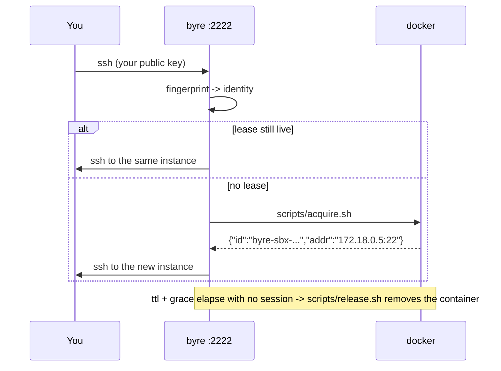

# Docker starter kit

The smallest complete byre deployment: one gateway process, sandboxes that are ordinary
docker containers, no Kubernetes.

Each SSH key that connects gets **its own container**, held for the lease TTL and then
released. Two people connecting at the same time get two different hosts; the same person
reconnecting inside the TTL lands back on the same one.

## What you need

- `docker`
- `byre` — a release binary or `go build ./cmd/byre`

## Run it

```sh
cd examples/docker-sandbox

# 1. Generate the pool key. The gateway keeps the private half; the public half is baked into
#    the sandbox image. Nothing is committed -- see .gitignore.
./scripts/keys.sh

# 2. Build the sandbox image.
docker network create byre-example 2>/dev/null || true
docker build -f Dockerfile.sandbox -t byre-sandbox:local .

# 3. Put your own key's fingerprint in byre-config.yaml.
ssh-keygen -lf ~/.ssh/id_ed25519.pub    # SHA256:... -- paste into identities[0].fingerprint

# 4. Start the gateway.
mkdir -p hostkey
byre -config byre-config.yaml
```

Connect as yourself:

```sh
ssh -p 2222 -i ~/.ssh/id_ed25519 sandbox@127.0.0.1 hostname
```

Run it twice. The hostname is the same, because the lease is still live. Wait past `ttl` +
`grace` and connect again — the hostname changes, because the container was released and a
new one started.

> If port 2222 is taken (a git server often is), pass `-listen :22022` and use `-p 22022`.

## What happens per connection



## The three scripts

The `command` provisioner is the only part of byre that knows how to create anything. It
runs three programs and reads JSON from them:

| script | when | contract |
|---|---|---|
| `scripts/acquire.sh` | an identity needs an instance | print one JSON object `{"id","addr"}`; `$BYRE_IDENTITY` is set |
| `scripts/release.sh` | a lease ended | remove that instance; `$BYRE_INSTANCE_ID` is set (not `$1`) |
| `scripts/list.sh` | gateway startup | print a JSON array of live instances |

`acquire` records the fingerprint as a container label (`byre.io.identity`, dot not slash —
docker rejects `/` in label keys) and `list` maps it back to `annotations."byre.io/identity"`.
That annotation is the only thing that decides adoption after a restart; without it the
instances are left alone rather than destroyed (ADR-0009).

Swap these three scripts for anything else — `systemd-run`, a VM driver, a cloud API — and
the rest of byre does not change.

## Containers are not VMs

Two things in `acquire.sh` exist because the sandbox is a throwaway container:

- `--cap-drop ALL` plus six `--cap-add`s: sshd needs `SYS_CHROOT` (it chroots to `/var/empty`),
  `SETUID`/`SETGID` (to become the user), `CHOWN`/`DAC_OVERRIDE` (to read the key), `KILL`.
  Drop everything else.
- `host_key_policy: insecure` in the config: docker reuses IPs, so a *changed* host key is
  normal. `accept-new` pins on first use and then refuses the next container on that IP.

## Kubernetes instead?

See [`../kubernetes-sandbox`](../kubernetes-sandbox): same gateway, same config shape, but
instances come from a CRD and the image built here is what the template runs.
